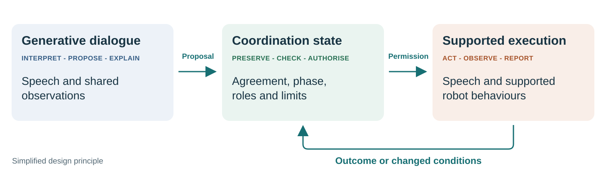

# Production notes: Human Robot Coordination

These notes support review and reproduction of the PDF. They are not poster copy.

## Purpose and reading distance

Attract conference attendees to the booth, then give them a reason to talk with
the Unitree G1 and explore Valerian on the demonstrator's laptop. The poster is
a conversation starter, not a condensed research paper.

- At a distance: title and "What would make this robot useful to you?".
- At normal poster-reading distance: the workflow, example dialogue and seven
  short guidelines.
- Close up: the complete recorded Valerian interaction, typeset for print.
  The user requested removal of the explicit booth invitation.

## A0 landscape composition and branding

The 2026-11-12 PDF follows the light theme of [SIRA Lab](https://www.siralab.ch/),
inspected in a real browser: Space Grotesk, ink `#0c1618`, paper `#f6f7f4`,
teal `#00b0a2`, orange `#ff7a00`, thin borders and rounded white panels. A quiet
geometric grid echoes the site's hero background. Darker teal and orange are
used for readable small text. The earlier five-colour workflow remains an
alternative asset; the print version uses the website palette.

| Area | Approximate height | Role |
| --- | --- | --- |
| Institutional header | 6% | Website SIRA Lab element left; original ZHAW mark and institute name right. |
| Title and motivation | 14% | Exact title, question and two motivation lines; the "despite" correction beside them. |
| Workflow | 28% | Five stages with example dialogue and return paths, spanning the page. |
| Design and demonstration | 48% | Seven numbered guidelines and challenges left; all 18 messages in two ordered columns right. |
| Footer and spacing | 4% | Brief evidence statement and restrained lab/platform identifier. |

The full interaction replaces the four-message excerpt. Removing the invitation
makes room for the challenges. The state screenshot and control diagram are
retained as supporting assets, but are not added to this PDF.

The seven guidelines use full-width numbered rows in the lower-left column,
with 25 pt bold headings and 24 pt body text. Moving the handwritten correction
into the open space beside the title makes room without shrinking the copy.
The PDF builder reads the guideline wording directly from `POSTER.md`.

### Guideline scope

Capability awareness adds one guideline; workflow awareness strengthens the
previous "Guide the interaction", and escalation expands "Make repair easy".
The four guidelines on agreements, state, shared grounding and reflection remain.

- Capability awareness covers supported abilities, current resource availability
  and limits. It is a functional description, not a claim of consciousness or
  unrestricted knowledge of the robot's physical condition.
- Workflow awareness supports explaining the current stage, suggesting next
  steps and deliberate navigation. Acceptance and task-control constraints still
  govern transitions; a change of direction does not bypass them.
- Recovery includes noticing observable failures or uncertainty, communicating
  implications and seeking human help when needed. Human-reported problems,
  clarification, correction, pause, stop and renegotiation remain part of repair.
  The guideline does not imply that the prototype detects every possible fault.

The PDF is one page at exactly **1189 x 841 mm**. It uses 25 mm left/right main
content margins, a 109 pt title, 40-46 pt main section headings and 24 pt full
dialogue text. Main copy is 24-29 pt; compact challenge copy is 22-24 pt. Small
speaker labels are 16 pt and captions/footer 19-20 pt. The detailed interaction
is intended for close reading. Fonts are embedded; figures, logo and text remain
vector. Print at actual size (100%). No physical print proof has been inspected.

### Institutional marks and font provenance

- Left: recreate the site's actual HTML/CSS brand element: the gradient rounded
  square with `S`, **ZHAW SIRA Lab**, and **Socially Intelligent and Responsible
  Agents**. This website element is typography/CSS, not a separate image logo.
- Right: preserve the six original vector paths of the ZHAW mark extracted from
  `D:\SVN_ACQ_SocialRobotics\SIRALab\09_Plakat_SIRA Lab_PRINT.pdf`, top-left region
  of page 1. Add the requested **ZHAW Institut für Wirtschaftsinformatik** label.
  Only the logo paths are retained; no hidden source-poster content or photographs
  are included. SVG, small PDF and transparent PNG versions are in `assets/`.
- `assets/institutional-header.svg` previews the same header arrangement for
  Markdown. The PDF draws its header directly and embeds the vector ZHAW mark.
- Space Grotesk comes from the Google Fonts `ofl/spacegrotesk` source. Static
  regular/medium/bold instances and the OFL licence are in `assets/fonts/`.
  Segoe Print Bold, installed on this Windows machine, is embedded for the single
  handwritten correction; its font file is not redistributed with the sources.

## Figure 1: the workflow

`assets/coordination-workflow.svg` is an original vector redraw informed by the
five stages in `D:\SVN_HumanAICollaboration\Presenting\img\workflow-generic.png`.
It preserves Opening, Alignment, Planning, Execution and Reflection; Execution
is the audience-facing label for the original Orchestration stage.

`assets/coordination-workflow-print.svg` is the compact SIRA-styled version used
in the PDF and current Markdown. `build_poster.py` regenerates it. Its example
dialogue serves the same five stages and preserves both return paths.

- Human and robot utterances are distinguished explicitly.
- The human's "Yes, start now" sits at the transition from planning to execution.
- Changed circumstances return execution to clarification and agreement.
- Reflection returns to planning for agreed changes to the next execution.
- Speech and shared observations support coordination throughout the workflow.

The dialogue is illustrative poster copy, not a transcript or a guaranteed
word-for-word response from the prototype. The five stages are a conceptual
interaction model, not a one-to-one rendering of the implementation's states.

## Figures 2 and 3: generative AI and explicit control

`assets/despite-generative-ai.svg` carries the proposed handwritten correction.
Keep it a secondary visual provocation. Its accompanying explanation acknowledges
the value of generative AI and identifies the responsibility of explicit control.

`assets/coordination-control.svg` illustrates the design principle: generated
interpretations and proposals are subject to explicit task state and permissions.
It is a simplified diagram, not a complete runtime architecture or a claim that
all sensing and physical control use the same pipeline.

Stateful prompt orchestration is part of the implementation. The broader design
also persists agreements, controls transitions and limits execution. Do not
imply that state machines make model interpretations infallible.

Alternative implementation figure, retained for layout review:



The original three vector figures have adjacent PNG exports for preview. The
PDF uses vectors directly, including a newly typeset handwritten correction.

## Current challenges panel

The panel connects the "despite" provocation to an open engineering question:
how can quick conversation remain faithful to the agreement? It sits below the
guidelines, beside the full example interaction.

Use three small cards with the same typography and spacing as the guidelines,
a pale warm background and the existing amber accent. Give each card a short
heading and one sentence; retain the single "Next" line beneath them. The
Markdown table specifies content, not a requirement to print a bordered table.
This is a secondary panel of about 80 words, not another dominant figure.
The title and workflow remain the strongest elements.

The three cards group the four proposed concerns:

- **Beyond speech:** coordinate non-verbal sensing, plans and robot-initiated
  behaviour under the same agreement. This is an integration challenge, not a
  claim that speech models categorically lack multimodal or proactive abilities.
- **Keep speech aligned:** combine changing workflow instructions with the
  challenge of controlling fast generated replies. Updates must reach the speech
  model in time, and the resulting behaviour still needs checking. Avoid a
  universal ranking of speech models against frontier text models: our evidence
  concerns specific native Live runs, prompts and required task facts.
- **Check communication:** distinguish an input transcript, the interpretation
  used for a decision, generated words, actual audio and observed playback. A
  transcript does not expose the model's internal interpretation or certify
  exact acoustic output. Playback confirmation does not prove that the human
  heard or understood the message. Clarification and explicit agreement remain
  necessary ways to establish shared meaning.

### Current implementation versus next work

ES-08 retained Live input but moved committed Coordination replies to the
existing Speech service, using backend-selected text and muting native Live
output. This addresses the observed omissions and unsupported additions in
native replies; it does not establish perfect synthesis or transcription.
Describe speech-to-speech as an interaction experience rather than claiming
that the current Coordination path uses one native model for both directions.
See `.agents/ES08_SPEECH_DELIVERY_DECISION.md` and the current acceptance section
of `.agents/ESCALATION_RESULTS.md` for evidence and acoustic-review limitations.

Low-latency voice models help responsiveness, but acceptable end-to-end delay
in physical human-robot interaction has not yet been established by our trials.
The proposed next work is to measure response onset and completion, fidelity
to the agreement, and interruption/recovery behaviour together in physical
trials, then reduce delay without weakening task or delivery controls. These
are proposed evaluation targets, not new results or a claim that ES-08 is open.

### Provider documentation supporting the discussion

Checked on 2026-11-12; keep these API details off the printed poster:

- [Managing GPT-Live sessions](https://developers.openai.com/api/docs/guides/live-conversations):
  instructions and context can be appended during a session, but a reply can
  precede full use of an update. Instruction acknowledgment, transcript events
  and playback are distinct. The disclosure guidance calls for checking audio
  itself to verify wording. Workflow changes therefore require synchronised
  context and application control, not necessarily replacing the whole prompt.
- [Server-side controls](https://developers.openai.com/api/docs/guides/voice-server-controls):
  applications enforce task rules and control playback. Checking native speech
  before delivery requires buffering and handling audio and transcripts
  separately. A later correction cannot retract speech already heard.

## Screenshots and provenance

The owner supplied an example of Valerian's state view in the conversation and
authorised capturing the following live views for this draft:

- Interaction: https://valerian-e613edef27a0.herokuapp.com/valerian/index.html?mode=detached&panel=interaction&agentId=576e4749-32f1-4a6b-9588-22a0800e8aaf
- State window: https://valerian-e613edef27a0.herokuapp.com/valerian/state-view-window.html

The standalone state window needs its connected cockpit opener; its URL alone
does not identify an agent or populate the graph. Capture existing data without
submitting utterances, starting tasks or changing agent state. Keep credentials,
access codes and unrelated conversations out of poster assets.

For the state view, distinguish the blue current state from an orange selected
node. Selecting "Coordination execution" does not establish that it is running.
Suggested caption: "Inside Valerian: inspect coordination states and transitions."

Captured on **2026-11-12**, from the authorised live Heroku agent:

- `assets/valerian-interaction-full.png`: all 18 messages, from the opening
  introduction through return to conversation. The conversation viewport was
  expanded to show the entire record. Wording, order and UI styling are unchanged.
  The capture was checked against all 18 previously recorded messages; the agent
  state stayed unchanged and no utterances or task controls were submitted.
  `target/poster-full-capture-audit.json` contains the private capture record.
- `assets/valerian-interaction-full.json` and `TRANSCRIPT.md`: the complete
  speaker/text record used to typeset the PDF. It preserves punctuation and case,
  including the original double full stop. Message numbers and the two column
  headings are editorial aids, not additional turns. Existing Unicode punctuation
  is preserved in these verbatim messages.
- `assets/valerian-interaction.png`: four contiguous existing messages, from the
  gesture-triggered task proposal through acceptance and waiting for a fresh cue.
  Only the conversation viewport was resized and scrolled; wording, order and
  message styling are unchanged. This earlier excerpt is no longer used.
- `assets/valerian-state-machine.png`: the actual standalone state view in its
  light theme. It shows 10 states and 47 transitions, with Coordination
  conversation current. No node was selected to imply a different current state.

The conversation excerpt records an earlier execution stage; the state graph
shows the later return to conversation. They are not a synchronised execution
snapshot. Both were captured at three device pixels per CSS pixel. Each view
was visually checked. The access code and surrounding access toolbar are absent.
No utterances or task controls were submitted; the agent's state before and after
capture was unchanged. A private capture record remains in ignored
`target/poster-ui-capture.json`.

The example is a playful demonstration of agreeing a conditional speech task,
not evidence of broad everyday utility. It is a complete conversation record,
not a claim that every recorded message was acoustically verified.

## Claims and demonstration boundaries

- Position the work as design guidelines illustrated by an implemented agent.
- The accepted evidence is iterative engineering and scenario testing. Do not
  imply a completed user study or general proof of better everyday HRI.
- Ad-hoc tasks remain bounded by supported capabilities. Do not promise general
  manipulation, navigation or arbitrary new physical skills.
- Gestures and shared observations support both task configuration and execution.
  Pointing-direction interpretation is an illustrative extension, not a verified
  capability of the current Coordination Agent.
- Speech-to-speech describes the experience. It does not require a single native
  audio model; the implementation can separate transcription, control and synthesis.
- Reflection proposes changes for renewed agreement. It does not imply automatic
  model learning or unapproved changes to future tasks.
- A fluent response or observed playback does not prove human understanding.

The screenshot, model and five-stage diagram each explain a different level.
Avoid presenting a screenshot as proof of usability or the conceptual workflow
as a literal enumeration of runtime states.

## Background for booth discussion, not a large reference panel

Coordination and human direction have established foundations in HRI. The poster
should claim a concrete synthesis and implementation experience, not invention
of coordination, multimodality or explicit state control.

- Johnson et al. (2014), [Coactive Design: Designing Support for Interdependence
  in Joint Activity](https://doi.org/10.5898/JHRI.3.1.Johnson).
- Ahn et al. (2022), [Do As I Can, Not As I Say: Grounding Language in Robotic
  Affordances](https://arxiv.org/abs/2204.01691).
- Kim, Lee and Mutlu (2024), [Understanding Large-Language Model (LLM)-powered
  Human-Robot Interaction](https://arxiv.org/abs/2401.03217).

Local implementation anchors: `.agents/CONTEXT.MD`, the current ES-08 entry in
`.agents/ESCALATION_RESULTS.md`, `CoordinationAgent.java`, and the Valerian state
view. Their test counts and provider details belong in supporting discussion,
not the attention-catching poster copy.

## Build and verification

From the repository root:

```powershell
python .doc/posters/human-robot-coordination/build_poster.py
```

The script uses ReportLab, svglib and PyMuPDF, with an optional local dependency
directory at `target/poster-python`. Rebuilding the handwritten correction needs
Windows Segoe Print Bold. The output is
`output/pdf/human-robot-coordination-a0-landscape.pdf`; layout measurements and
intermediate files stay under ignored `target/poster-print`.

Verification includes the single-page A0 dimensions, embedded fonts, all seven
guidelines matching the Markdown, all 18
complete messages in order, text bounds, Markdown links and Poppler-rendered
visual inspection. The output preview is
`output/pdf/human-robot-coordination-a0-landscape.png`. These are document checks;
no application, paid-provider or physical robot tests are required for this change.

## Remaining production choices

The requested institutional marks are included. Add individual author names,
contact details or a public QR destination only if subsequently requested.
The demo URL requires an access context and should not automatically become a
public poster QR code. Keep editorial notes and raw source URLs off the print.
