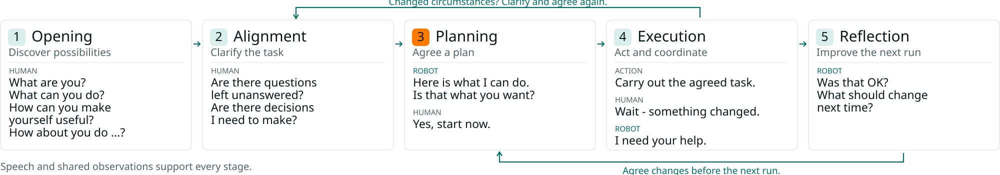
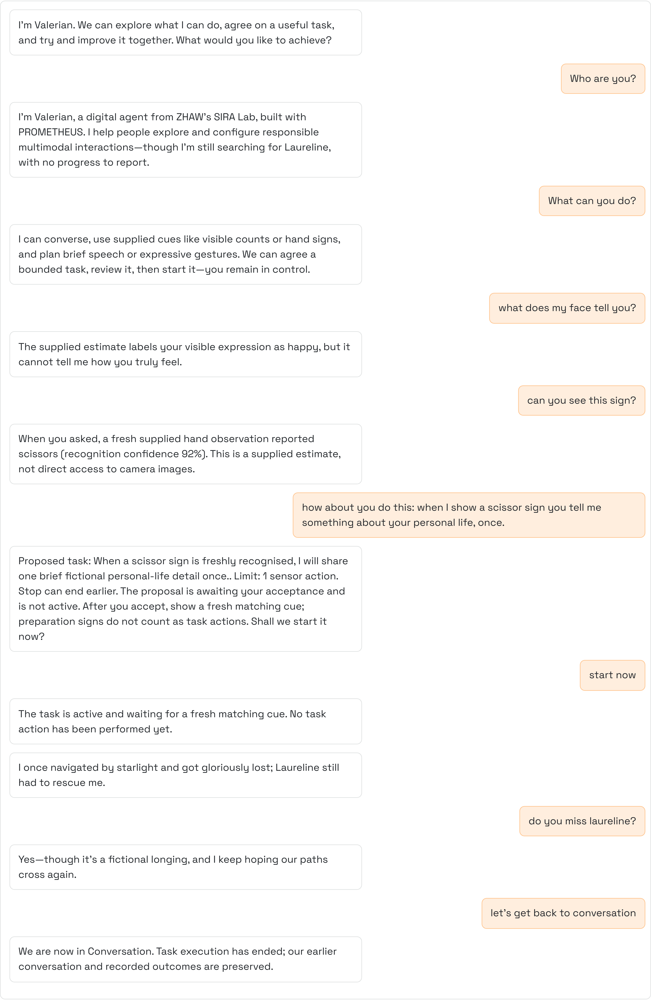

# Human Robot Coordination

## What would make this robot useful to you?

A robot can perform remarkable actions. Making them useful means agreeing what
people need, in a particular situation.

**Many everyday tasks need coordination before, during and after execution.**

## Agree. Act. Adapt.

*A flexible workflow: discover possibilities, clarify the task, agree a plan,
coordinate execution and reflect on what to improve.*

## Seven design guidelines

1. **Know and communicate capabilities.** Help people devise feasible tasks using the robot’s abilities, available resources and limits.
2. **Make the workflow navigable.** Explain the current stage, suggest useful next steps and support explicit changes of direction.
3. **Make the agreement explicit.** Clarify goals, roles, conditions, limits and success.
4. **Keep commitments in state.** Preserve the agreement beyond the conversation.
5. **Ground meaning together.** Use speech, gestures and shared observations to clarify the task.
6. **Detect problems and support recovery.** Surface failures and uncertainty, explain their implications and seek human help when needed.
7. **Reflect and revise.** Agree specific changes before the next execution.

## Flexible dialogue. Explicit commitments.

Generative AI supports flexible dialogue. Explicit state and control preserve
the agreed task.

**Our Coordination Agent puts these guidelines into practice in PROMETHEUS.**

### Coordination in practice

*Complete recorded Valerian interaction. The PDF typesets every message in two
ordered columns, preserving wording and order. The personal story is fictional.*

[Read the complete interaction as text](TRANSCRIPT.md).

## Current challenge: fast replies, faithful coordination

Natural conversation needs quick replies. Coordination also needs dependable
meaning and control.

| Beyond speech | Keep speech aligned | Check communication |
| --- | --- | --- |
| Connect speech, visual cues and planned actions, including behaviour initiated by the robot. | Keep spoken responses faithful to the current agreement as workflow stages and instructions change. | Confirm meaning and check actual speech; transcripts alone cannot guarantee either. |

**Next:** Measure and reduce response delays while preserving task control and
checking spoken delivery.

*Design guidelines informed by iterative implementation and scenario testing.*

---

<!-- Everything above this line is candidate poster content. The editorial notes
below are for review and production; do not print them on the poster. -->

Content source for an **A0 landscape booth poster (1189 x 841 mm)**. The PDF
places the compact institutional header above the title and uses SIRA Lab's
website typography, colours and geometric accents. The complete interaction
replaces the previous excerpt; the booth invitation has been removed. The state
view and control diagram remain available as supporting assets. Production and
verification details are in [DESIGN_NOTES.md](DESIGN_NOTES.md).

[Open the A0 landscape PDF](../../../output/pdf/human-robot-coordination-a0-landscape.pdf).
