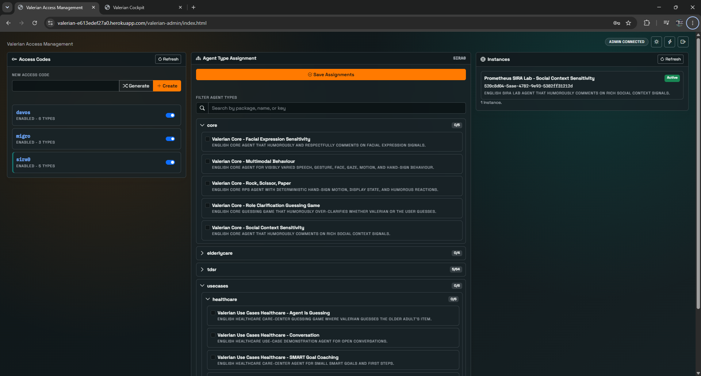
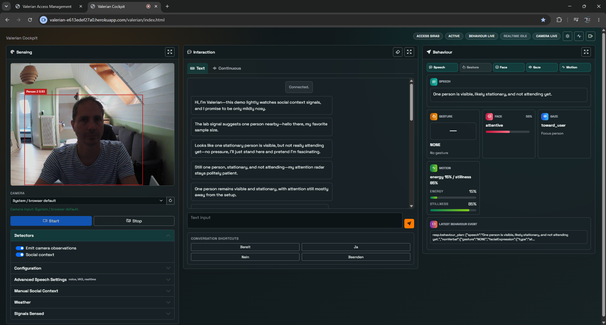
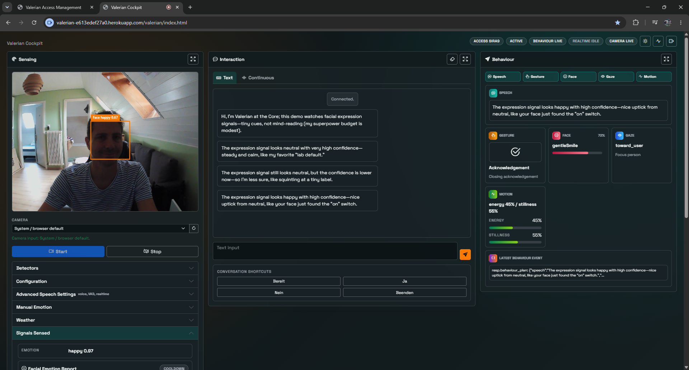
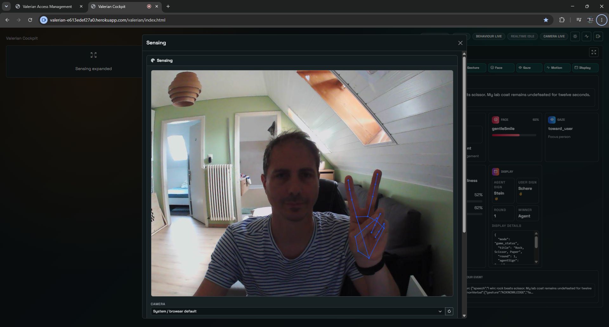
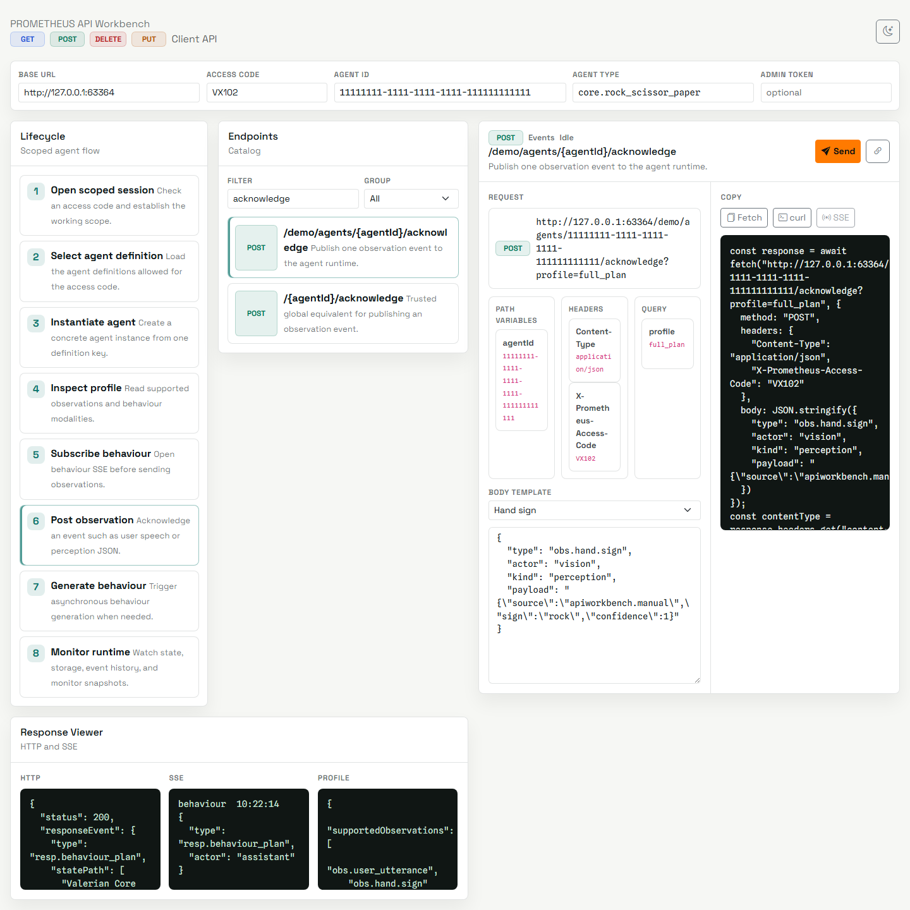

# PROMETHEUS

PROMETHEUS is an event-driven Java framework for building multimodal digital
agents with explicit state-machine control, a developing regulation layer, and
structured behaviour output.

## Why

Many agent systems still treat interaction as turn-based chat: a user says
something and the agent replies. That is too narrow for digital agents that must
work with voice, facial expression, hand signs, group context, weather, and
other signals while deciding when to speak, gesture, stay silent, or yield.

PROMETHEUS focuses on the mapping problem behind multimodal agents: how sensed
events from humans and environments become inspectable agent state, and how that
state becomes coordinated speech, nonverbal behaviour, motion intent, or display
output.

## What

PROMETHEUS provides an engineering framework for digital agents that may remain
screen-based, be embodied as VR avatars, or be connected to physical robots.
Agents are explicit state machines, not opaque chat loops. Their task logic is
implemented with states, transitions, guards, actions, prompts, and storage.

The framework treats multimodality as a first-class contract:

- Perception clients publish observations as `Event` objects.
- Agents declare accepted observations and emitted behaviour modalities through
  an `AgentInteractionProfile`.
- Agent responses are persisted as `BehaviourPlan` events with `speech`,
  `nonVerbal`, `motion`, and `display` channels.
- Streaming clients subscribe to behaviour events and render the channels that
  their target avatar, robot, or UI can support.

## How

Every runtime input is normalized as an event. A user utterance, facial emotion
sample, social grouping report, hand sign, weather context, system tick, and
internal regulation signal use the same event pipeline. The current state
decides whether the event changes control flow, updates storage, or triggers a
new behaviour plan.

The regulation foundation runs alongside task control, can maintain persisted
variables, and can emit internal opportunities back through the state machine.
Direct multimodal motivation, arbitration, and modulation of generated
behaviour are not complete yet. The state machine therefore remains explicit
and authoritative while the regulation layer develops.

## Bundled Clients

### Valerian Access Management

URL: `http://localhost:8080/valerian-admin/`



Use this client to create new access codes and assign the agent types made
available in the scope of each access code. A valid access code must be entered
before using Valerian Cockpit.

### Valerian Cockpit

URL: `http://localhost:8080/valerian/`

Valerian Cockpit is the primary all-in-one client for trying the core agents
that ship with PROMETHEUS. After entering an access code, open the drawer on
the right with the heartbeat button, choose an agent type, create an instance,
connect to it, and reset or delete it when needed. The drawer's diagnostics tab
shows runtime events and agent state.

In **Diagnostics → State machine**, **Float state view** moves the current-state
label and state list over the cockpit. Drag its title bar, or focus the title and
use arrow keys, to move it. **Maximise / Restore** expands it within the tab;
**Open state view in separate window** places it in a browser popup, where the
normal window controls handle movement and maximisation. Popup permission may
be required. **Dock state view** returns to Diagnostics; **Close** or Escape
dismisses the detached view and leaves it available in Diagnostics.

The view follows the original cockpit's selected connection and monitor updates,
including nested current states, without another agent session or data stream.
Disconnecting or switching agents clears the previous state. Logout, navigation
or closing the original cockpit also closes its state popup. Refresh the cockpit
after deployment to load the new controls.

The cockpit is organised into three columns: sensing, verbal interaction by
text or speech, and behaviour. Each column can be maximised or opened in a
separate window when an experiment needs more screen space.

Speech interaction is transcription-first: Valerian commits explicit browser
audio turns to `gpt-live-transcribe`, sends only finalized transcripts through
the ordinary scoped acknowledgement boundary, and synthesizes speech from the
resulting persisted behaviour event. New `behaviour-live` deliveries can
produce audio; ordinary history and reconnect replay remain visual-only. When
an operator starts transcription, Valerian also requests and speaks the latest
eligible assistant utterance in the agent's current state before opening
microphone input. While speech is loading or playing, microphone input is
disabled and its pending provider state is cleared so the agent cannot
transcribe itself. **Stop Playback** cancels queued/current audio and reopens
input without changing the persisted plan. A per-agent browser lease selects
one audible Valerian window, and playback uses the speaker, voice, and speed
selected in the speech settings.

In **Continuous → Speech Output Settings**, Audio format defaults to
**Automatic (PCM when supported)**. The cockpit prepares a PCM renderer and the
selected speaker before requesting audio; unsupported or failed preparation uses
MP3. Select **MP3** for a comparison using the same voice, speed and transcription
preset. The existing voice/speed controls now live in this visible output panel;
saved settings are retained. Format changes apply to the next reply and controls
are locked during output. Refresh after deployment to load the new player.

**Conversation pace** in Live Transcription Settings offers Ultra Responsive
(0.5-second silence, minimal provider delay), Responsive (0.8 seconds, low delay),
and Pause tolerant (1.5 seconds, medium delay).
Pause tolerant remains the default. Presets change only these two values; saved
language, noise and device choices remain intact. Manual turn completion and
custom silence/delay values remain available. The shared multilateral listener
offers the same choices. Settings are locked during an active session.

Ultra Responsive shortens the configured silence interval by another 300 ms
relative to Responsive; actual speech-end-to-playback improvement depends on
turn segmentation and downstream timings. Longer within-sentence pauses may
split a turn. The Transcription delay dropdown remains independently adjustable.
Previously saved 0.5-second/low settings remain intact and now show Custom. After
updating, reload the cockpit and select Ultra Responsive while stopped to apply
0.5-second/minimal settings before starting transcription.

To try a 1,000 ms pause, stop transcription, select local VAD and set
**Silence duration (seconds)** to **1.0**, then restart transcription. The pace
selector shows Custom; provider delay can be selected separately.

Responsive reduces the local silence wait by 700 ms, but the frozen synthetic
pause replay produced extra segments at that threshold. Even 1.5 seconds split
the longer hesitation. Neither setting is certified for hesitant healthcare or
far-field speech; use longer custom timing or manual turns where needed. Run
`node tests/needforspeed/replay-vad.mjs` for the offline segmentation comparison.
It does not measure ASR accuracy or provider latency.

Weather is a manual input under **Sensing → Weather**. **Fetch Current** previews
Open-Meteo data without sending an observation. **Send Current** and **Send
Forecast** submit the respective observation to the connected agent, fetching
first when needed. Use **Fetch Current** again to refresh a cached reading.
The status beside these buttons and in **Signals Sensed → Weather Report**
distinguishes fetched, sending, sent and failed operations. A successful send
confirms acknowledgement; whether the agent responds depends on its current policy.
Hand and weather reports use the same dark-mode surfaces as the other reports;
their background colour does not indicate whether sensing or sending is enabled.

Camera hand sensing publishes classified rock, scissor or paper signs through
`obs.hand.sign`; the blue landmark overlay only confirms local detection.
Sending requires a connected agent, **Emit camera observations**, the configured
hand confidence threshold (default 0.65) and three consecutive detections of the
same sign. The Hand Sign Report shows the blocking reason, **Stabilizing**, or
**Emitted** with the last successful acknowledgement time; **Emit failed** means
the request did not succeed. A held eligible sign is sent again after 2.5 seconds.
Live and Generic task perception expire hand readings after 15 seconds without
a fresh observation. The telemetry export omits sensor payloads; check the
diagnostic activity log for `ack obs.hand.sign` when tracing camera ingress.

Agents can identify a hand-capture window with an opaque `display.captureId`
(1-128 characters) alongside `awaitingUserSign: true`. The cockpit echoes it as
`captureId` in camera and manual `obs.hand.sign` payloads. A new ID resets stability
and resend cooldown once; repeated opening plans retain both. A matching
`awaitingUserSign: false` closes capture, and replaying that opening does not reopen
it. IDs are scoped to the connected instance and cleared on cockpit reset. Delayed
requests keep their original ID and cannot restore a newer window's cooldown/status.
The agent validates the ID; it is correlation, not authorization or hand ownership.
Displays without an ID keep the existing uncorrelated sensor behavior.

#### Cockpit lifecycle contract

The sensing, interaction, and behaviour columns represent the currently
connected agent only. An empty column contains no agent-derived history,
starter message, sensing value, or behaviour value; operator lifecycle notices
belong in diagnostics rather than the conversation.

| Lifecycle state or action | Cockpit columns |
| --- | --- |
| Access screen, accepted access code, selected agent type, or newly created instance | Empty. Selecting or creating an instance does not imply a connection. |
| Connect to a new instance | Cleared first, then initialized from that agent's current starter behaviour and subsequent events. |
| Connect to a previously used instance | Cleared first, then hydrated in persisted order with its conversation and the latest facial, social, hand-sign, weather, and behaviour values. |
| Switch instance, failed connection, or disconnect | Empty. Disconnect retains the selected instance so it can be reconnected explicitly. |
| Reset a connected instance | Cleared first, then initialized from the reset agent's new starter behaviour. |
| Log out and access the cockpit again | Empty, with access, selection, diagnostics, and agent URL identity removed. |

An explicit `agentId`/`agent` URL is the intentional exception: it identifies a
specific agent for direct-link and detached-column use and therefore attempts
that connection on load.

#### Social Context Sensitivity



This core agent demonstrates social-context sensing.

- Sensing: visual detection of human presence, groups of humans, and whether
  people are attentive toward the agent.
- Interaction: the agent comments on the social situation; users can also enter
  utterances or use transcription-first speech interaction.
- Behaviour: the full behaviour spectrum, including speech, gesture, facial
  expression, gaze, motion, hand signs, and display output where supported.

#### Facial Expression Sensitivity



This core agent demonstrates facial-expression sensing.

- Sensing: visual detection of faces and emotion, valence, and arousal.
- Interaction: the agent comments on the social situation; users can also enter
  utterances or use transcription-first speech interaction.
- Behaviour: the full behaviour spectrum, including speech, gesture, facial
  expression, gaze, motion, hand signs, and display output where supported.

#### Rock-Scissor-Paper



This core agent demonstrates a hand-sign game loop.

- Sensing: visual detection of the user's hand sign: rock, scissor, or paper.
- Interaction: ready, draw a sign, and receive the evaluation of who won; text-
  and speech-based interaction remain available.
- Behaviour: the full behaviour spectrum, plus the additional hand sign drawn
  by the agent.

### Talk to Me

URL: `http://localhost:8080/public/talktome`

Talk to Me is a reduced, public-facing Valerian-style output-only speech client.
An administrator first assigns `core.talk_to_me` to an access code. The user
then enters that code and explicitly creates, selects, and deletes their own
scoped speech instances.

Enter up to 2,000 Unicode code points and choose **Speak** to persist and speak
that exact text without language-model rewriting. The client exposes the OpenAI
Speech voices, output speed, browser speaker selection, and speaker refresh;
`alloy` is the fresh-user voice default while an explicitly saved choice is
retained. Voice and speed are locked only while a synthesis/playback request is
active. Speaker selection remains available and applies immediately. The client
does not request microphone access.

The supplied sample is loaded into the speech field on every page load. The
icon controls above the field restore that sample or clear the field; they
become available with the textarea after selecting an instance.

The browser sends one scoped speech request. PROMETHEUS first persists the
canonical `BehaviourPlan`, then sends that plan's unchanged speech channel to
OpenAI's output-only Speech API. The browser buffers the returned MP3 before
playback and reports completion only when the audio element emits `ended`.
**Stop** aborts an in-flight request or stops current playback. The
2,000-code-point boundary remains an application policy.

### API Workbench

URL: `http://localhost:8080/apiworkbench/`



The API Workbench is a guided developer client for learning and testing the
PROMETHEUS REST and SSE API. Start with the lifecycle column: open a scoped
session, list allowed agent definitions, create or select an agent, inspect its
interaction profile, subscribe to behaviour or monitor streams, and publish
observation events. The endpoint catalog can also be used directly to inspect
resolved URLs, path variables, headers, query parameters, JSON request bodies,
copyable `fetch`, `curl`, and `EventSource` snippets, HTTP responses, SSE
events, and the active agent profile.

### Multilateral Displays

URLs:

- Listener display: `http://localhost:8080/multilateral/listen/`
- Reports display: `http://localhost:8080/multilateral/reports/`

The multilateral screens are separate meeting/group displays. They are not part
of the Valerian cockpit workflow, but remain bundled for situations where a
larger audience should see live listening state or generated meeting reports.

## Current Agent Catalog

Production agent definitions live under
`src/main/java/ch/zhaw/prometheus/agentdefs`. Definitions implement
`AgentDefinition`, expose a stable key, and are discovered as Spring beans.

The main branch ships the Valerian baseline catalog:

| Key | Purpose |
| --- | --- |
| `core.coordination` | Coordinate dialogue and sensor tasks through persisted agreements, preparation, execution and reflection. |
| `core.facial_expression_sensitivity` | Core demo for facial-expression observations. |
| `core.multimodal_behaviour` | Core demo for coordinated multimodal output. |
| `core.generic_multimodal_behaviour` | Collaboratively configure a persistent task and react to multimodal cues. |
| `core.generic_multimodal_behaviour_at_social_space` | Concise English Valerian conversation, arrival/departure reactions and the shared Generic task lifecycle. |
| `core.live_multimodal` | GPT-Live conversation with independent full embodiment and all supported observations; requires Live for speech. |
| `core.rock_scissor_paper` | Core hand-sign rock-scissor-paper demo. |
| `core.role_clarification_guessing_game` | Core guessing game focused on agent/user role clarity. |
| `core.social_context_sensitivity` | Core demo for social grouping and rich social context. |
| `core.talk_to_me` | Deterministic exact-text output-only speech utility. |
| `usecases.healthcare.guessing_game` | Healthcare guessing game where Valerian guesses. |
| `usecases.healthcare.guessing_game_user_guess` | Healthcare guessing game where the user guesses. |
| `usecases.healthcare.healthcare_conversation` | Open healthcare conversation use case. |
| `usecases.healthcare.smart_goal_coaching` | Healthcare SMART-goal coaching use case. |
| `usecases.healthcare.therapy_appointment_reminder` | Single-state therapy appointment reminder. |
| `usecases.healthcare.therapy_appointment_reminder_intro` | Two-state therapy appointment reminder with introduction. |

Conversational definitions share restrained, recurring digital-agent
self-irony: brief, varied asides when appropriate, not a joke every turn. Facts,
task instructions, agreed wording and permission to speak take priority; serious,
medical and distressing moments remain free of humour. Explicit closing prompts
and Talk to Me's exact-text output are unchanged. Create new instances for consistent
coverage: persisted prompts are not migrated. This is prompt guidance, not an
enforced humour frequency, and requires no cockpit update or extra model calls.

Conversational **core** agents additionally share `ValerianPersona` and
the packaged [core reference](src/main/resources/ch/zhaw/prometheus/agentdefs/core/reference.json).
It contains SIRA Lab/IWI information and Theresa Schmiedel, Marc Styger, Jasmin
Grassmugg and Alexandre de Spindler; SML, Reto Steiner and Gala/event information
are omitted. Dated sources and local-document provenance remain in JSON audit
metadata; only compact facts enter prompts, without URLs or runtime lookups.
Alexandre's lab-direction role is descriptive, not an asserted formal title.

Valerian's fictional peacekeeper backstory borrows confidence, action-oriented
energy and reliance on Laureline's resourcefulness from *Valerian and the City of
a Thousand Planets*. This adaptation adds mild grumpiness about missing Laureline
and an unsuccessful ongoing search. It remains an occasional character detail,
never a real mission, new task, reason to disregard confirmation or complaint
about visitors. Real authorship stays with the SIRA Lab; knowledge of lab equipment
does not imply a physical embodiment. Healthcare personas and exact-text Talk to
Me do not acquire this fictional layer. Use new instances for consistent coverage.

Event- or experiment-specific agents should live in application branches,
separate modules, or deployment-specific code rather than being added to the
main baseline catalog.

## Requirements

- Java 21 or newer.
- MySQL.
- Maven Wrapper from this repository.
- Node.js only when running the Playwright visual smoke tests.
- OpenAI or Azure OpenAI configuration for prompt generation, live
  transcription, and output-only Speech synthesis.

## Local Setup

Copy the template files and adjust them for your machine:

```powershell
Copy-Item src/main/resources/application.properties.template src/main/resources/application.properties
Copy-Item src/main/resources/openai.properties.template src/main/resources/openai.properties
```

Minimum configuration:

- `spring.datasource.url`
- `spring.datasource.username`
- `spring.datasource.password`
- `openai.openaivsazureopenai`
- `openai.url`
- `openai.key`
- `openai.liveTranscriptionClientSecretUrl` and
  `openai.liveTranscriptionWebRtcUrl` only when overriding the standard OpenAI
  live-transcription endpoints
- `openai.liveTranscriptionSafetyIdentifier` when a stable,
  privacy-preserving provider safety identifier is required
- `prometheus.speech.model` and `prometheus.speech.url` when overriding the
  shared output-only Speech synthesis defaults
- `prometheus.admin.token` for Valerian Access Management

Run the application:

```powershell
.\mvnw.cmd spring-boot:run
```

The default local URL is `http://localhost:8080`; it redirects to Valerian
Cockpit.

Open the main surfaces:

- Valerian Cockpit: `http://localhost:8080/valerian/`
- Valerian Access Management: `http://localhost:8080/valerian-admin/`
- Talk to Me: `http://localhost:8080/public/talktome`
- API Workbench: `http://localhost:8080/apiworkbench/`
- Multilateral listener: `http://localhost:8080/multilateral/listen/`
- Multilateral reports: `http://localhost:8080/multilateral/reports/`

Live transcript capture preserves an already measured acoustic boundary before
processing the next chunk. Application-owned speech can accept a short reply after
a later completed native question; stale announcements do not permanently block
it. Changed/overlapping context still requires clarification. This does not recover
missing provider transcription or prove audible delivery. Evidence:
[GI-02 results](.agents/GALAIMPROVEMENT_RESULTS.md).

## Testing

Executable task JSON optionally declares `firstAction: "ON_CUE"` to wait for a
fresh matching observation after acceptance. Omission or `"IMMEDIATE"` keeps the
legacy initial action. `ON_CUE` acceptance spends no action and emits no agreed
motion; `maxActions` counts subsequent actions. Existing saved tasks are not
reinterpreted. Applications must explain the timing before acceptance.

Use a disposable local MySQL schema and a restricted test account, supplied through
`SPRING_DATASOURCE_URL`, `SPRING_DATASOURCE_USERNAME` and
`SPRING_DATASOURCE_PASSWORD`. Several integration fixtures delete stored agents;
some classes named `*UnitTest` also start a database-backed Spring context. Keep
the developer database out of these runs. Disable scheduled ticks with
`PROMETHEUS_RUNTIME_TICK_ENABLED=false` for deterministic fixtures.

Run the Java regression suite:

```powershell
.\mvnw.cmd test
```

Run JavaScript syntax checks for the bundled clients:

```powershell
node --check src/main/resources/public/valerian/script.js
node --check src/main/resources/public/apiworkbench/script.js
node --check src/main/resources/public/talktome/script.js
node --check tests/playwright/valerian-column-expansion.spec.mjs
node --check tests/playwright/apiworkbench.spec.mjs
node --check tests/playwright/talktome.spec.mjs
```

Run the Playwright visual smoke tests:

```powershell
npm install
npx playwright install chromium
npm run test:valerian:visual
npm run test:apiworkbench:visual
npm run test:talktome:visual
```

The Valerian Playwright test starts or reuses `http://127.0.0.1:8080`, creates
or re-enables access code `VX102` through the admin API, and checks the facial
expression report, social context report, and behaviour board. The API
Workbench Playwright test uses deterministic mocked API responses to verify the
guided lifecycle, snippets, request execution, and SSE viewer. Set
`PROMETHEUS_ADMIN_TOKEN` when your local `prometheus.admin.token` differs from
the test default. Set `PROMETHEUS_SKIP_WEBSERVER=true` when the app is already
running.

The Talk to Me Playwright test uses the running Spring application and its
configured test database for access-code assignment, scoped agent lifecycle,
exact event/behaviour persistence, synthesis request mapping, audio completion,
Stop, and deletion. It replaces only the external OpenAI Speech and physical
speaker boundary with deterministic browser fakes, then checks the light
desktop and dark mobile layouts. It uses access code `TTM31` and the same
admin-token environment override.

### Database connections and streaming

The shared `application.yaml` sets `spring.jpa.open-in-view=false`, including
when using an existing local `application.properties`. Keep this setting disabled
in deployment overrides. Database reads return the required eager agent graph;
repository transactions finish before SSE streams or speech playback remain open.
Behaviour and monitor streams retain their existing history, event IDs, heartbeat
and reconnect contracts. An idle cockpit must not reserve JDBC connections.

Scoped agent creation validates access before initial generation, performs provider
work without a creation transaction, then revalidates the same access-code identity,
enabled status and allowed type inside the short save transaction. The agent and
its access-code link commit together; both initial behaviour and monitor publication
follow commit. Revocation while generation is pending rejects the result. A provider
failure or failed association leaves no newly persisted agent. This changes the
creation boundary; existing Live transcript transaction/receipt guarantees remain
as implemented.

Use the isolated local-MySQL runner to check the real servlet/SSE lifecycle:

```sh
python tests/gptlive/run_acceptance.py --java-tests SseConnectionPoolIntegrationTest
# Full Java regression plus real classroom/Live smoke and cockpit UI checks:
python tests/gptlive/run_acceptance.py --java-tests all --browser
# Use a separate local database properties file (the named schema is never touched):
python tests/gptlive/run_acceptance.py --database-properties src/main/resources/application-test.properties --java-tests all --browser
```

Set `GPTLIVE_MYSQL_ADMIN_URL`, `GPTLIVE_MYSQL_ADMIN_USER` and
`GPTLIVE_MYSQL_ADMIN_PASSWORD` to local administrative credentials when the local
application properties point elsewhere. The runner rejects remote hosts and
creates a disposable schema/account. The regression opens sixteen streams for
eight agents with a ten-connection pool, exercises login, creation, interaction,
persisted-ID speech and reconnect replay, and checks that idle streams release
all connections. Providers are synthetic; this is not an acoustic or production
throughput benchmark. Evidence is in `.agents/CONNECTION_LIFECYCLE_RESULTS.md`.

Ordinary acknowledge/generate turns reuse a persistence context under the existing
agent lock. A short loading transaction includes Live ownership validation; the
JDBC connection is released before inference, and the ordinary save commits each
event. Contexts end with the turn or bounded sensor sample. This avoids detached
graph merge reads without caching authorization, holding transactions across
ordinary provider waits, or changing durable Live transcript transaction owners.
`QueryVolumeIntegrationTest` measures HTTP costs and MySQL session `Questions`
with a one-connection pool, including transaction overhead and provider-wait checks.

Shared Hibernate collection batch fetching (`default_batch_fetch_size=64`) bounds
round trips for complex state graphs while retaining eager/detached access.
Live transcript claims use scalar scope/epoch checks and bounded bulk receipt
reads/assignment, with a separately committed claim before processing. Every
fragment remains durable; revocation, original receipt ordering and no automatic
replay of uncertain actions are preserved. No schema migration is needed.
New Live receipts use one autocommitted MySQL statement that checks the current
scope, epoch and duplicate identity before inserting. Ambient transactions are
suspended, so later turn rollback cannot lose an accepted receipt. No permission
cache or fragment buffer is introduced. The writer requires the default pool
autocommit setting and fails closed otherwise. Segment claims/processing keep
their separate transactions. Storage entries use the existing join table as a
set, allowing individual link removal without rewriting unrelated entries. A separate
eager SELECT prevents storage from multiplying the state/policy graph's query rows.
Complete-history display reads only the history/events/paths after the ordinary
scope check, preserving event identity/order and fresh data without a cache.
The local regression checks actual MySQL `Questions`, including JDBC work and
transaction commands; Hibernate statement counts alone omit the receipt writer.
The deployment branch also tests a mixed Gala speech/sensing minute: 2,031 MySQL
questions versus 4,731 before these changes. Sustained load at that rate exceeds
the documented 36,000/hour plan; this regression test is not a capacity guarantee.
See `.agents/GPTLIVE_RESULTS.md` for workload, verification and deployment limits.

The browser acceptance adds eight separate access-code contexts that join in
sequence, keep sixteen native SSE streams open, send concurrent turns, and check
scoped persisted history, disconnect/reconnect, switching instances and reload.
Its pool metrics endpoint exists only in the synthetic test fixture, never in
the production application. Install the locked npm dependencies and Playwright
Chromium first (`npm ci` and `npx playwright install chromium`).

### Combined behaviour generation

Every `PromptPolicy` generation requests one JSON behaviour plan, including
final states. Speech-only policies request the minimal `{"speech":"..."}` object;
policies with nonverbal instructions use the compact encoding below. Java composes the existing
outer, task, starter and nonverbal instructions; custom persisted prompts remain
in place and gain this behaviour after reload. Structured nonverbal instructions
apply inside `nonVerbal`, and gesture-only instructions apply to its `gesture`
field. Optional motion/display objects retain the existing contract.

The provider response uses `speech` and `nv`, with these fields inside `nv`:

| Compact field | Canonical nonverbal field |
| --- | --- |
| `g` | `gesture` (same semantic label) |
| `f: [type, intensity]` | `facialExpression: {type, intensity}` |
| `z: [direction, focus]` | `gaze: {direction, focus}` |
| `m: [stillness, energy]` | `motion: {stillness, energy}` inside `nonVerbal` |
| `x: {...}` | Other nonverbal fields under their full names, including custom, partial, null or extended objects |

Only exact field pairs use tuples; `x` preserves other shapes without inventing
missing values or losing extensions. Top-level `motion` (including hand signs)
and `display` remain ordinary full-name objects. Speech and all string contents
remain unchanged; only JSON formatting whitespace is omitted. Expansion precedes
existing validation and event publication, so stored plans, history, HTTP/SSE and
clients always use the canonical field names. Existing agents gain compact
instructions on their next generation; no recreation or cockpit setting is needed.

Canonical provider responses remain accepted for authored prompts/custom gateways.
Timing exports distinguish `behaviour_decode_compact` from
`behaviour_decode_canonical`; neither includes response content. Malformed compact
tuples, unknown short keys and overlapping short-key/`x` definitions fail without
a repair request or partial speech. Compare actual completion tokens and latency
in the Telemetry export; a shorter JSON representation alone does not
establish a deployment speedup.

Generic task replies/cues and Social Space ambient replies also use this codec.
Configuration keeps the exact `operation`, `task`, `reply` envelope; compact
behaviour belongs inside `reply`, including `reply.motion` for hand signs.
`task: null`, optional speech and `{}` silence retain their meanings. Expansion
precedes task-specific validation, including the canonical 1,800-character limit
and channel restrictions. Canonical replies remain accepted. Encoding guidance
is appended at inference time without changing saved prompts, task rules,
model routes, call counts or state control. See `.agents/NEEDFORSPEED_RESULTS.md`
for evidence and limits.

Deterministic RPS output and Talk to Me still construct plans without model calls.
Speech-only policies use the same typed `BEHAVIOUR` / `JSON_OBJECT` inference path
and validation/publication boundary as combined policies; the raw-text generation
branch has been removed. No nonverbal defaults are added to speech-only replies.
Existing final states gain this behavior after reload without prompt migration.
Invalid structured output fails without
retrying or publishing partial speech. Unknown gesture labels become `NONE`;
unsupported nonverbal move/turn fields are removed as before. The obsolete second
nonverbal request and third gesture-repair request have been removed.

With ordered guards, ordinary coaching uses three text requests: two decisions
and one combined behaviour request. With the default combined guard strategy it
uses two: one guard group and one behaviour request, down from four at baseline.
Startup and direct facial/social reactions use one generation request. These are
offline call-count results; measured provider latency and response quality are
tracked separately in the results ledger.

The execution roadmap is in `.agents/PLAN_TRANSITION_EXECUTION.md`.

### Background transition actions

New transition actions default to background execution in the Spring application
runtime. Use `action.blocking()` when later actions, guards or state-entry prompts
need its result. Gather/choice dependencies and RPS updates explicitly block;
summary/outcome recording runs in the background on any transition. There is no
cockpit switch. Embedded `PolicyRuntime` instances without an `ActionExecution`
host still execute on the caller thread.

An action's `prepare` method freezes selected events, resolved prompts and values
on the agent thread and returns `PreparedAction` work that captures no entities.
The worker computes JSON storage writes; only the application applies them under
the existing agent lock in a fresh transaction. Custom background actions must
implement this contract; custom blocking actions retain `execute`.

Work starts after successful turn commit and runs FIFO per agent. Different
agents can progress concurrently. Reset/delete invalidates obsolete results;
write tokens prevent overwriting a newer foreground value. Accepted earlier
background writes are accounted for so queued writes preserve their order.
Failures never remove an already-published farewell or trigger a model retry.

This queue is intentionally **in memory**: queued/running work may be lost on a
Heroku restart. Configure `prometheus.actions.parallelism` (4), `.capacity` (64,
running plus reserved/queued jobs), and `.queue-timeout-ms` (30000). Admission
does not wait or silently fall back to blocking: exhaustion fails the turn before
persistence. Queue expiry and worker failures are explicit logged failures.
`background_action` logs correlate job/agent/action/turn IDs and completion,
failure, conflict or shutdown status. The HTTP timing export records
`action_queued`; completion after the HTTP response is only in server logs.

Schema update adds nullable `action.execution_mode`, `agent.execution_epoch`, and
`storage_entry.write_token` columns through the existing Hibernate update setup.
Existing stored summary/outcome extraction actions and summarisation actions gain
background execution on reload. Known SmallTalk/coaching summary states also
migrate their legacy action modes. Other legacy actions keep blocking semantics;
newly authored actions default to background. Deploy coordinated writers: these
in-process ordering guarantees do not support multiple independent agent writers.
Completed storage remains durable; no job records or restart recovery are added.

### Speculative conversational behaviour

The Spring runtime starts one eligible current-state behaviour request alongside
transition evaluation. If no transition occurs, the next explicit generation can
reuse it, including across separate acknowledge/generate HTTP requests and entity
reloads. Publication still follows the ordinary validated BehaviourPlan path.
Any transition (including an inner transition or self-loop) discards the candidate
immediately; new-state generation proceeds after required blocking actions without
waiting for the old request. Reset, deletion, newer input, rollback, expiry and
changed effective prompts/model routes also prevent reuse.

This is enabled by default with the OpenAI gateway, including Heroku; no cockpit
switch or agent recreation is needed. Eligibility requires a user utterance,
no-op regulation, ordinary State/OuterState and PromptPolicy composition, the
default prompt assembler, and known pure guards including a model decision.
Custom states/policies/guards/assemblers, deterministic policies, unconditional
transitions and sensory observations retain their existing path. Custom gateways
must explicitly support speculative inference and concurrent requests.

Configure `prometheus.behaviour.speculation.enabled` (true), `.parallelism` (2
active speculative requests), `.capacity` (64 retained candidates), and `.ttl-ms`
(30000 from preparation). There is no waiting worker queue: saturation skips
speculation. Required decisions and fresh behaviour do not use these permits.
The cache is in memory and local to one process; use a single agent writer.
Set `PROMETHEUS_BEHAVIOUR_SPECULATION_ENABLED=false` for a sequential comparison.

Transitions can cost an extra model request. Cancellation is best effort and may
not stop provider billing or computation; provider contention can reduce the
latency benefit. A reused failed/invalid candidate fails normal generation without
a hidden retry; failures of discarded candidates cannot publish a response.

The interaction timing panel/export includes started, reused, discarded and wait
markers. Completed speculative inference evidence is marked `scope=speculative`
with its original trace; that duration can overlap an earlier HTTP request and
must not be added to request latency. Request IDs prevent double counting in CSV.
Still-running discarded work can finish after response headers, so its usage may
only appear in correlated server logs. Missing usage remains unknown.

### Task-specific text inference

The text SPI accepts typed `InferenceRequest` snapshots with purpose, messages,
output shape, optional JSON schema, request ID and correlation ID. Existing
semantic gateway methods remain available for custom/test gateways. Purposes
are `behaviour`, `nonverbal`, `decision`, `extraction`, and `summary`; they are
explicit in code rather than guessed from prompt wording.

`openai.model` remains the fallback. Configure `openai.reasoning-effort` and
`openai.routes.<purpose>.model`, `.reasoning-effort`, `.max-completion-tokens`,
`.timeout-ms` or `.url` to override a purpose. Blank effort uses the provider
default. The template contains an opt-in Sol/Luna configuration with `none`
effort; no existing installation switches models automatically. The output cap
includes reasoning tokens. Text HTTP requests have a 30-second default deadline
and a 10-second connection deadline; failures do not retry or escalate models.

The checked-in `openai-prod.properties` enables the requested Heroku testing
configuration: Luna for behaviour, nonverbal, decision, extraction and summary,
all with explicit `none` reasoning effort. Each purpose retains its independent
route, so behaviour and decisions can still use different models. GPT-5.2 remains
the global fallback.
The ordinary local template stays opt-in. Heroku environment variables can
override file values; effective model/effort appear in the inference timing logs.

For Azure, the URL identifies the deployment. A model override must include its
matching deployment URL; `model` identifies the underlying model for capability
validation and is not sent in Azure payloads. Offline routing tests use loopback
HTTP providers. Heroku recordings cover Sol behaviour and Luna decisions;
Luna behaviour quality/latency and Azure deployment access remain unverified.

Optional sampling parameters are omitted on reasoning model families to avoid
model/effort incompatibilities. This changes the former temperature-zero decision
payload on GPT-5.2; compare decision quality before promoting candidate routes.
Non-reasoning models retain temperature 1 for behaviour and 0 for structured
work. Invalid booleans/JSON, missing content, refusal, filtering and truncated
completions fail explicitly. Provider error bodies are not included in errors.

Provider references: [GPT-5.6 Sol](https://developers.openai.com/api/docs/models/gpt-5.6-sol),
[GPT-5.6 Luna](https://developers.openai.com/api/docs/models/gpt-5.6-luna) and
[GPT-5.2](https://developers.openai.com/api/docs/models/gpt-5.2). Sol/Luna support
Chat Completions and `none` effort; account access and task quality remain to be
established for each deployment.

### Response latency diagnostics

POST requests accept an optional UUID `X-Prometheus-Trace-Id` and return a validated
trace ID. A request that publishes behaviour also returns
`X-Prometheus-Behaviour-Id`, identifying the persisted event delivered on SSE.
These headers do not grant access or change event payloads. Configured CORS
origins can send/read them.

The existing scoped monitor stream also publishes `activity` snapshots (version 1):
bounded, transient operation IDs, execution epoch, stage starts/finishes, outcomes,
server durations, safe inference metadata and aggregated task cue waiting reasons.
Concurrent operations remain distinct. This collection adds no database polling or
model calls; retention is 128 agents, 32 concurrent operations and 128 entries per
agent, with idle expiry after 30 minutes and explicit omission counters. Server
restart loses this transient history. Cue diagnostics observe existing decisions;
they never activate tasks. Live status also retains cumulative provider usage,
context utilisation and safe error/close codes, excluding provider error messages.
See `.agents/PLAN_TELEMETRY.md` and `.agents/TELEMETRY_RESULTS.md` for rollout evidence.

In Valerian, open **Agent & Diagnostics → Telemetry**.
The interaction card has one shared status footer across Text, Continuous and
GPT-Live. It combines in-flight backend stages with existing transcript ingress
and playback observations. Thinking means an observed model request; this is a
progress label, not model reasoning. Intentional cue waiting is static. A stale
active stream becomes Progress unavailable instead of claiming continued success.
Elapsed times use the clock which measured the work. Browser speech/output
activity is not proof of physical audibility.

The footer flag marks speech cutoffs, long pauses, unexpected responses or missed
cues. Markers contain timestamps and active operation identities, never free text;
their association to audio is approximate. JSON now includes `activity` journals,
coverage and markers, and Live requested/applied capture settings, cumulative
provider usage, context utilisation and safe error codes. Live configuration includes
the existing silence/lateness/open-segment/audio-gap limits, including the separate
user silence window (`userSilenceMs`), request deadline and
Heroku build identity when the platform supplies it. Missing evidence remains
unknown. Existing turn fields and ordinary-turn CSV remain compatible; filenames
now begin `prometheus-telemetry-`. Browser activity retention is 16 recordings,
1,024 entries per recording and 64 markers, with explicit omission counters.

Recording is automatic for submitted speech/text turns; expand a turn to inspect milliseconds
from estimated speech end through commit, final transcription, backend processing,
cockpit refresh and playback. The shared footer includes acknowledgement, model
work, behaviour generation, persistence and playback activity.

**Export JSON** includes detailed browser stages, each acknowledgement/fallback/
Speech HTTP request, available server spans, actual text-model routes/effort and
reported token usage, applied capture flags, turn settings, and playback mode.
**Export CSV** provides one comparison row per turn. No transcript, assistant
text, prompts, access codes, provider credentials, device IDs or audio is included.
Export before reloading or clearing; reset/disconnect preserve the recording.
The drawer shows the latest 20 turns and exports all retained turns (up to 128).
Startup/restart assistant replay does not alter a previously recorded turn.

`X-Prometheus-Timing` carries a base64-encoded version-1 JSON snapshot with
request-relative server duration and spans. It is capped at 6,000 characters/
64 spans and marks truncation explicitly. JSON responses attach it before body
serialization; streaming Speech attaches it before streaming begins, without
buffering the audio. Pure guard workers share only bounded request-local
measurements. There is no trace lookup endpoint or cross-request server cache.
Headers omitted by a proxy, work still running at the snapshot, and truncated
detail are incomplete evidence. Server spans can overlap or contain one another;
do not add them or subtract their timestamps from browser timestamps.

Server `latency` log entries record inference purpose, model, effective configured effort (or provider default),
token counts when supplied, application/persistence/publication durations and
Speech response-header time. Durations are monotonic. Successful provider prompt
and response bodies are no longer logged by the text gateway.
Valerian retains at most 128 content-free turn and event timing records in memory:
`PrometheusTimings.snapshot(agentId)`. Transcript ingress, canonical SSE receipt,
rendering, first audio byte and media `playing` are joined even when SSE beats
the HTTP response. Shared transcription records the last detected voice, local
VAD turn boundary, successful local commit send, provider commit acknowledgement
receipt, first/last non-empty transcript delta receipt, and final transcript receipt.
Final receipt is recorded before waiting for earlier items to finish, preserving
the distinction between transcription finalisation and ordered submission.
Manual turns record commit send/receipt without an invented speech-end timestamp.
The panel, CSV and offline reporter include commit-send-to-acknowledgement,
acknowledgement-to-final, first-to-last-delta and last-delta-to-final intervals.
Acknowledgements and transcripts use browser receipt times, not provider clocks;
these intervals include network delay. Deltas can arrive before speech ends or a
commit is sent, so the timeline supports negative offsets relative to speech end.
Missing acknowledgements/deltas and older exports leave those measurements unknown.
The existing committed stage remains the local VAD boundary for comparison with
older recordings; commit_sent records the separate successful send boundary.
Browser timing telemetry is not uploaded, and timing data is not durably persisted.
Speech delivery diagnostics are retained temporarily in bounded server memory and
fetched into the same export. Server and browser clocks are separate; correlate
IDs, then compare local durations.
Speech end is the local VAD estimate and playback is a browser renderer/media
event, not a measurement at the physical speaker. Unsubmitted/failed ASR items
and startup replay do not create turn records; missing stages remain unknown.

Run `node --test tests/js/performance/*.test.mjs` and
`CatalogInferenceCountUnitTest` for offline diagnostics checks. The roadmap and
measured/unverified results are maintained in `.agents/PLAN_NEEDFORSPEED.md` and
`.agents/NEEDFORSPEED_RESULTS.md`.

The drawer's JSON export can be shared directly or summarized without Heroku logs:

~~~powershell
node tests/needforspeed/summarize.mjs target/interaction-timing.json
~~~

Browser exports label their source as `browser`; they do not certify that the
provider or media was unmocked. Filter turns by settings and annotate warm/cold,
ordinary/closing workload and physical device/network conditions before comparing
latency distributions.

For separately collected fixtures or live experiments, save JSON with `metadata`
and `turns` fields. Set metadata `source`
to `fixture` or `live`, `configuration` to a description of the actual settings,
and `workload` to e.g. `warm ordinary SMART`. Include browser/device/network,
corpus revision, model/effort/guard strategy and speech/transcription settings in
metadata. Set `turns` to `PrometheusTimings.snapshot(agentId)`; export before the
128-record limit evicts samples or the recording is cleared. Then run:

```powershell
node tests/needforspeed/summarize.mjs target/turn-export.json target/server.log
```

The offline reporter calculates browser-stage p50/p95, counts missing/invalid
stages and errors, consumes embedded server timings and optionally joins
text-request/usage logs by opaque trace ID. Missing
usage stays unknown; the report does not estimate cost from incomplete logs.
It flags samples below 50 and never mixes browser and server clocks. A fixture
report cannot establish live latency, model quality or physical audibility.

For reproducible database/browser checks, `node tests/needforspeed/provider-stub.mjs`
starts a synthetic provider on loopback port 8091. Point a separate test app's
`OPENAI_URL` at `http://127.0.0.1:8091/v1/chat/completions` and
`PROMETHEUS_SPEECH_URL` at `http://127.0.0.1:8091/v1/audio/speech`; use a dummy
`OPENAI_KEY`, `OPENAI_OPENAIVSAZUREOPENAI=openai`, and the isolated datasource.
Set `OPENAI_LIVETRANSCRIPTIONCLIENTSECRETURL=http://127.0.0.1:9/session` to keep
unmocked transcription requests local, and remove any purpose-route URL overrides
for that test process. The stub always rejects guards and serves fixed fixture
speech; it is not a quality evaluator. Start the app on a dedicated port and set
`PROMETHEUS_BASE_URL`, `PROMETHEUS_SKIP_WEBSERVER=true` and the test admin token
for Playwright. The exact integrated test commands are in the results record.

## Connecting External Clients

External clients usually use the scoped demo API. It keeps agent instances
behind an access code and mirrors what the Valerian cockpit does. Trusted
backend tools can use the global agent endpoints shown later.

### 1. Open a scoped session

Create an access code and assign agent types in Valerian Access Management, or
use the admin API. Then validate the code:

```http
POST /demo/session
Content-Type: application/json

{
  "accessCode": "VX102"
}
```

The response contains the enabled agent types and existing scoped agents.

### 2. Create or select an agent

List agent types available to the code:

```http
GET /demo/agent-types
X-Prometheus-Access-Code: VX102
```

Create an assigned agent type:

```http
POST /demo/agents
X-Prometheus-Access-Code: VX102
Content-Type: application/json

{
  "agentDefinitionKey": "core.social_context_sensitivity"
}
```

Read the agent metadata before enabling perception or rendering controls:

```http
GET /demo/agents/{agentId}/info
X-Prometheus-Access-Code: VX102
```

Relevant response fields:

```json
{
  "id": "11111111-1111-1111-1111-111111111111",
  "name": "Valerian Core social context sensitivity",
  "description": "English Valerian Core agent for social-context sensing.",
  "active": true,
  "languageCode": "en",
  "interactionProfile": {
    "supportedObservations": [
      "obs.user_utterance",
      "obs.human.presence",
      "obs.social.grouping",
      "obs.social.context"
    ],
    "supportedBehaviourModalities": [
      "speech",
      "nonVerbal.gesture",
      "nonVerbal.facialExpression",
      "nonVerbal.gaze",
      "nonVerbal.motion"
    ],
    "profileTags": []
  }
}
```

Clients should use `supportedObservations` to decide which sensing UI or sensors
to enable, and `supportedBehaviourModalities` to decide which behaviour channels
to render. An empty profile means "unknown"; fall back conservatively.

### 3. Publish perception events

Send observations to the agent with `acknowledge`:

```http
POST /demo/agents/{agentId}/acknowledge
X-Prometheus-Access-Code: VX102
Content-Type: application/json

{
  "type": "obs.user_utterance",
  "actor": "user",
  "kind": "observation",
  "payload": "What do you notice about this group?"
}
```

`payload` is always a string. For structured observations, encode the structured
payload as JSON inside the string:

```json
{
  "type": "obs.hand.sign",
  "actor": "user",
  "kind": "observation",
  "payload": "{\"source\":\"external.camera\",\"hand\":\"right\",\"sign\":\"rock\",\"confidence\":0.93,\"detectionMode\":\"client_camera\",\"ts\":\"2026-07-08T09:00:00Z\"}"
}
```

The response is:

```json
{
  "responseEvent": {
    "type": "resp.behaviour_plan",
    "actor": "assistant",
    "kind": "response",
    "payload": "{\"speech\":\"I saw rock. I will reveal mine now.\",\"motion\":{\"handSign\":\"paper\"}}",
    "createdDate": "2026-07-08T09:00:01Z",
    "statePath": ["Valerian Core RPS Reveal Sign"]
  },
  "active": true
}
```

`responseEvent` may be `null` when the event updates context but does not trigger
new behaviour.

For one sensor sample, `POST /demo/agents/{agentId}/observations` accepts an array
of one to four requests with the same fields and access-code header. It accepts
face, presence, grouping, social context, hand and weather observations; utterances
and internal events use their existing routes. Each item is acknowledged in order,
revalidates access and commits separately, including ordinary transitions, actions,
derived social events and SSE publication. The HTTP 200 body is an ordered array
of `{ "status": 200, "response": { ... } }` results. Failed items return status
401, 404 or 500 with a null response, without undoing earlier successful items;
subsequent items still run. Invalid batches return HTTP 400 before processing;
initial scope failure returns HTTP 401/404. There is no whole-batch automatic retry.
Valerian uses this for presence/grouping/context from one camera sample, retaining
existing sensing intervals, change detection and five-second Live freshness refresh.

Supported observation event types in the current public contract:

| Event type | Actor | Payload |
| --- | --- | --- |
| `obs.user_utterance` | `user` | Plain utterance text. |
| `obs.emotion.face` | `user` | JSON string with `emotion`, `confidence`, `valence`, `arousal`, optional `expressions`, source, and timestamp. |
| `obs.human.presence` | `user` | JSON string with aggregate human/tracked counts and source. |
| `obs.social.grouping` | `user` | JSON string with group count, singleton count, largest group size, groups, and source. |
| `obs.social.context` | `user` | JSON string with `schemaVersion: 1`, aggregate group fields, and per-person movement/attention fields. |
| `obs.hand.sign` | `user` | JSON string with `sign` as `rock`, `scissor`, or `paper`, plus confidence/source fields. |
| `obs.weather.current` | `system` | JSON string with location, condition, intensity, wind, temperature, precipitation, and timestamp. |
| `obs.weather.forecast` | `system` | JSON string with location and `days[]` forecast entries. |

Use only observations declared by the agent profile unless you are deliberately
testing fallback behaviour.

### 4. Subscribe to behaviour

Behaviour clients subscribe with Server-Sent Events:

```http
GET /demo/agents/{agentId}/behaviour/stream?accessCode=VX102
Accept: text/event-stream
```

Browser `EventSource` cannot set custom headers, so scoped browser clients pass
`accessCode` as a query parameter. Non-browser clients may use the
`X-Prometheus-Access-Code` header instead.

Each behaviour event has:

- SSE event name: `behaviour-live` for a new publication or
  `behaviour-replay` for initial/history/reconnect recovery
- SSE id: persisted event id when available
- SSE data: an `Event` object with type `resp.behaviour_plan`

The event `payload` is a JSON string containing a `BehaviourPlan`:

```json
{
  "speech": "That looks like a small group.",
  "nonVerbal": {
    "gesture": "ACKNOWLEDGE",
    "facialExpression": { "type": "attentive", "intensity": 0.55 },
    "gaze": { "direction": "toward_group", "focus": "group" },
    "motion": { "stillness": 0.75, "energy": 0.35 }
  },
  "motion": {
    "handSign": "paper"
  },
  "display": {
    "title": "Social context",
    "summary": "Two people nearby"
  }
}
```

Clients should ignore channels they cannot render. Reconnect with either the
standard `Last-Event-ID` header or `?lastEventId=<id>` to replay missed
behaviour events. Replayed events retain their original persisted IDs, data,
and order, but are labeled `behaviour-replay`; clients must not repeat live-only
effects such as speech playback for them. Heartbeats remain SSE comments.
Valerian correlates both persisted event IDs and stable event-envelope
fingerprints so an initial-history response followed by an SSE replay renders
the same behaviour only once.

### 5. Request generated behaviour without a new perception event

Clients can ask the current state to generate another complete behaviour plan:

```http
POST /demo/agents/{agentId}/behaviour/generate
X-Prometheus-Access-Code: VX102
Content-Type: application/json

{
  "outputProfile": "FULL_PLAN",
  "omitModalities": ["display"]
}
```

`FULL_PLAN` is the only output profile. The profile can be omitted because it is
also the default. `omitModalities` remains available when a renderer explicitly
cannot consume one of the otherwise supported behaviour channels.

The endpoint returns `200` when behaviour was generated, `409` when no behaviour
was produced, `404` when the agent is missing, and `400` for an unknown profile.

### 6. Monitor state and storage

Use these endpoints for diagnostics and operator UI:

```http
GET /demo/agents/{agentId}/state
GET /demo/agents/{agentId}/states
GET /demo/agents/{agentId}/storage
GET /demo/agents/{agentId}/eventhistory
GET /demo/agents/{agentId}/monitor/stream?accessCode=VX102
```

The monitor SSE stream emits `snapshot` events with current state, inner state
chain, active flag, known states, and storage entries.
After text/transcription turns, Valerian uses these snapshots while its monitor
stream is ready. Before the first snapshot or after a stream error, it falls back
to ordinary state/storage reads. Initial connection and reset still hydrate explicitly.

## Global Agent API

The global API is useful for trusted tools, tests, or internal services. It is
not access-code scoped.

| Method | Path | Purpose |
| --- | --- | --- |
| `GET` | `/agent` | List persisted agents. |
| `POST` | `/agent/singlestate` | Create an ad-hoc single-state agent. |
| `GET` | `/{agentId}/info` | Agent metadata and interaction profile. |
| `POST` | `/{agentId}/start` | Start the current state. |
| `DELETE` | `/{agentId}/reset` | Reset the agent. |
| `POST` | `/{agentId}/acknowledge` | Publish an event. |
| `GET` | `/{agentId}/prompt?profile=...` | Inspect the prompt contract. |
| `POST` | `/{agentId}/behaviour/generate` | Generate behaviour from current state. |
| `GET` | `/{agentId}/behaviour/stream` | Subscribe to behaviour SSE. |
| `GET` | `/{agentId}/monitor/stream` | Subscribe to monitor SSE. |

The request and response shapes are the same as the scoped demo API, without the
access-code header. Where a `profile` or `outputProfile` is accepted, omit it or
use `full_plan`; former speech/complement profiles are not supported.

## Transcription-First Speech

### Scoped live transcription

The transcription-first speech architecture uses an access-code-scoped,
transcription-only session contract. Read its agent-language-aware settings
descriptor first:

```http
GET /demo/agents/{agentId}/transcription/capabilities
X-Prometheus-Access-Code: VX102
```

Then issue an ephemeral `gpt-live-transcribe` WebRTC session:

```http
POST /demo/agents/{agentId}/transcription/session
X-Prometheus-Access-Code: VX102
Content-Type: application/json

{
  "turnDetection": {
    "type": "local_vad",
    "silenceDurationSeconds": 1.5
  },
  "noiseReduction": "far_field",
  "transcriptionPrompt": "محادثة مع وكيل بروميثيوس.",
  "transcriptionKeywords": ["بروميثيوس", "عائشة"],
  "languages": ["ar"],
  "transcriptionDelay": "medium"
}
```

Supported noise-reduction values are `near_field`, `far_field`, and `off`.
Supported turn modes are `local_vad` and `manual`; both keep provider turn
detection disabled so the browser commits explicit audio turns. Supported
languages are currently `ar`, `de`, and `en`, and delay accepts `minimal`, `low`,
`medium`, `high`, or `xhigh`. Omitted settings use far-field capture, local VAD
with 1.5 seconds of silence, the selected agent's language, and medium delay.

The response contains the ephemeral client secret, fixed model and session
type, settings schema version, OpenAI WebRTC URL, and a non-sensitive effective
settings summary. The prompt text and keywords are never echoed in that
summary. There is no combined speech-to-speech session or unscoped
transcription-session endpoint.

### Shared browser transcription engine

Valerian and `/multilateral/listen` use the same ES-module engine under
`public/transcription`. It acquires a cross-tab microphone lease, applies the
requested browser capture constraints, creates only a transcription WebRTC
data channel, commits local-VAD or manual turns, orders terminal transcripts by
provider item ID, and reconnects with a fresh scoped ephemeral secret. Partial
transcripts are display-only; a provider assistant response or remote media
track is reported as an unexpected diagnostic and is never rendered.

The operator panel exposes provider noise reduction, local/manual turn mode,
silence duration, context, keywords, expected languages, transcription delay,
input device, echo cancellation, noise suppression, automatic gain control,
and voice isolation when supported. The default group profile is far-field,
local VAD with 1.5 seconds silence, the agent language, medium delay, browser
echo/noise/gain processing enabled, and voice isolation disabled. Requested and
browser-applied capture values are displayed separately. Context and keywords
are intentionally not stored in local storage.

### Operational resilience and acoustic limits

The shared transport reacquires the selected microphone and requests a fresh
scoped ephemeral session after connection/data-channel failure or when the
active microphone track ends. It makes at most two automatic reconnect
attempts with exponential backoff; if they are exhausted, the operator sees
the last actionable failure instead of an indefinite reconnect state. Browser
`devicechange` events refresh the microphone and speaker choices.

Explicit Stop, page navigation, agent switch/delete, reset, and failed startup
release microphone tracks and the cross-tab lease. Reset follows the cockpit
lifecycle by stopping transcription and leaving it idle; the operator starts a
new session when ready. One browser tab owns microphone capture at a time, and
one Valerian tab owns audible output for each agent. A tab that retains the
microphone lease may keep accepting finalized provider events while hidden,
but browser background throttling, wireless-device behavior, network recovery,
and acoustic quality must still be checked on the target deployment hardware.

`gpt-live-transcribe` supplies transcript text, not speaker identity, in this
contract. PROMETHEUS can accept sequential turns from several people, but it
does not diarize them. Simultaneous or overlapping speech may be merged, split,
or partly missed and must not be treated as reliably attributed input. Manual
turn commit remains available when an operator needs an explicit boundary in a
difficult room.

Run its deterministic browser gates with:

```powershell
npm.cmd run test:transcription:unit
npm.cmd run test:speech:unit
npm.cmd run test:valerian:lifecycle
npm.cmd run test:valerian:transcription
npm.cmd run test:valerian:visual
```

These suites mock microphone, WebRTC, SDP exchange, and provider events. They
do not replace the real acoustic matrix in
`.agents/TRANSCRIBE_SMOKE_RESULTS.md`. Before release on a target installation,
record its actual microphone and speaker models and execute that matrix in
near-field, far-field, noisy/outdoor, wireless/Bluetooth, and multiple-speaker
conditions. Keep every unperformed row marked `NOT RUN`.

Final provider transcripts enter PROMETHEUS through the same scoped event
boundary as typed input:

```http
POST /demo/agents/{agentId}/acknowledge?profile=full_plan
X-Prometheus-Access-Code: VX102
Content-Type: application/json

{"type":"obs.user_utterance","actor":"user","kind":"observation","payload":"Hello Valerian"}
```

The shared browser ingress serializes final turns, suppresses duplicate/stale
provider terminals, and exposes queued, sending, accepted, rejected, and
provider-error diagnostics. Partial or failed provider input is never sent.
The acknowledgement response is used only for lifecycle/fallback decisions;
canonical `resp.behaviour_plan` rendering remains driven by the behaviour SSE
stream so the same plan cannot appear twice. If acknowledgement legitimately
returns no response event, the client preserves typed-input semantics by
requesting one normal `full_plan` generation.

Valerian enables audible agent output only after **Start Transcription**.
While transcription is stopped, connecting, resetting, and receiving new
behaviours update the chat and behaviour display without synthesizing or playing
audio. **Stop Transcription**, reset, disconnect and agent changes disable
output and discard pending playback, including delayed startup lookups.
**Stop Speech** cancels the current output while keeping transcription enabled.

While enabled, Valerian's output queue accepts `behaviour-live` events with non-empty speech
and a persisted SSE event ID. It processes those IDs in order and keeps
completed, failed, and deliberately skipped IDs distinct, so duplicate live
delivery and ordinary history/reconnect replay cannot speak twice. An explicit
transcription start may enqueue the latest assistant utterance from canonical
chat history again, including a fresh agent's starting message. If the latest
utterance is from the user, or no assistant speech exists, nothing is spoken.
State-history selectors do not restrict this lookup. This intentional resume
delivery is repeatable on later starts and still synthesizes only the persisted
plan. Startup replay and subsequent live replies use the same saved Speech
voice, speed and selected output device; there is no separate reset voice or
speed configuration. Synthesis begins through the
canonical event-scoped endpoint below, and playback is routed to the selected
output device. The microphone remains gated across a queued burst and opens
only after resume playback has been attempted; it reopens after completion,
Stop, synthesis/playback error, disconnect, or agent change. An expiring
cross-tab output lease ensures that only one Valerian page speaks a particular
agent's event.

### Output-only Speech

Any scoped client can request audio for the canonical speech in an already
persisted behaviour-plan event:

```http
GET /demo/agents/{agentId}/behaviours/latest/speech
X-Prometheus-Access-Code: VX102
```

This discovery endpoint returns `{ "eventId": "..." }` only when the latest
utterance in the agent's current-state history is an assistant behaviour plan
with speech. A later user utterance makes it return `204`, preventing stale
assistant speech from being replayed while a response is still pending. It
does not synthesize audio or mutate the agent.

Use the returned persisted identity with the canonical synthesis endpoint:

```http
POST /demo/agents/{agentId}/behaviours/{eventId}/speech?voice=cedar&speed=1.25
X-Prometheus-Access-Code: VX102
```

`eventId` is the UUID delivered as the behaviour SSE event ID. PROMETHEUS looks
up that event only in the scoped agent's history, requires a
`resp.behaviour_plan` with non-empty speech, and sends its exact persisted
speech to the provider. This endpoint has no request body and therefore cannot
synthesize browser-authored or foreign-agent text. It returns uncached,
streamed provider audio with an explicit `audio/*` content type. Unknown agents
or events return `404`; events that are not usable speech behaviours return
`409`; unsupported voices, formats, or speeds outside `0.25` through `4.0` return
`400`. The defaults are `alloy`, `1.0` and `mp3`. The optional `format=pcm` requests
24 kHz mono signed 16-bit little-endian samples, returned as
`audio/pcm;rate=24000;channels=1;encoding=s16le`. Clients must explicitly support
that format. Other format values (including WAV) are not part of this endpoint's
contract. Talk to Me and requests omitting format continue using MP3.

Talk to Me sends the observation and speech options to a scoped backend
endpoint:

```http
POST /demo/talktome/agents/{agentId}/speech?voice=cedar&speed=1.25
X-Prometheus-Access-Code: TTM31
Content-Type: application/json

{"type":"obs.user_utterance","actor":"user","kind":"observation","payload":"Exact text"}
```

The dedicated endpoint first verifies that the scoped agent carries the
`utility.talk_to_me` profile tag. PROMETHEUS then acknowledges the observation
with the ordinary `FULL_PLAN` output profile, persists the deterministic
`core.talk_to_me` speech plan, and passes that canonical speech string to
`prometheus.speech.url` using `prometheus.speech.model` (default:
`gpt-4o-mini-tts`). The Talk to Me endpoint retains its exact-text behavior and
`utility.talk_to_me` agent-tag restriction while sharing provider configuration,
voice/speed validation, and streamed HTTP audio mechanics with canonical
behaviour speech.

## Experimental GPT-Live

Application policies may override `ExternalVoicePolicy.livePendingGuidance()` to
allow narrowly described waiting remarks. This is model guidance, not a timer or
proof that a lookup/action is running. Defaults retain the existing acknowledgement
permission; activity-owned applications may narrow it without legacy task wording.
Camera hand-emission resets also fence older in-flight acknowledgements: a delayed
send cannot restore an earlier capture window's cooldown.

The `feature/gptlive` experiment uses `gpt-live-1` and the Live API, separately
from transcription/TTS. Enable with `prometheus.live.enabled=true` (or
`PROMETHEUS_LIVE_ENABLED=true`); the local template defaults to disabled, while
the production profile enables it. It requires the existing
OpenAI API credentials and model access. Valerian exposes an experimental third
**GPT-Live** tab beside Text and Continuous when enabled. Connect a supported
agent, choose voice/microphone/speaker settings, then explicitly click **Start
GPT-Live**. Tab selection, connection and reload never start capture. Use Chrome
on HTTPS or localhost. The roadmap and acceptance gates are in `.agents/PLAN_GPTLIVE.md`.

The client shares microphone and per-agent output leases with transcription/TTS.
Mute affects input only. Stop immediately silences output and releases tracks
before bounded backend finalization. Switching interaction tabs stops the current
speech mode; text input resumes after cleanup. Reconnect always creates a fresh
session. Both provisional speakers remain visible during overlap, then receipt IDs
reconcile captions with recorded conversation. Incomplete or unapplied captures
are labeled. Native speech preserves the current non-speech behaviour display.
Only benign device/capture/voice preferences persist in browser storage.
Requested/applied echo cancellation is visible; Bluetooth quality remains
unverified. The temporary `/live/probe.html` was removed in GL-06.

All REST requests below require `X-Prometheus-Access-Code` and a linked agent:

Before selecting an agent, scoped `GET /demo/live/capabilities` reports whether
the tab is enabled, its model and allowed voices; it never grants eligibility.

| Method and path below `/demo/agents/{agentId}/live` | Contract |
| --- | --- |
| `GET /capabilities` | Enabled flag, pilot eligibility, model, allowed voices, diagnostic-only marker. |
| `POST /sessions` | `{ "sdp": "v=0…", "voice": "marin" }`; returns 201 with an opaque local handle and SDP answer after sideband attachment. Unknown fields are rejected. |
| `GET /sessions/{handle}` | Bounded, content-free activity counters and event types. |
| `POST /sessions/{handle}/input?muted=true` | Waits for the corresponding provider mute/unmute acknowledgement. |
| `DELETE /sessions/{handle}` | Closes the session and reports whether finalization was confirmed. |

Agent and session scope mismatches return 404; invalid access codes return 401;
invalid settings return 400; disabled sessions return 503; an occupied agent or
full capacity returns 409; provider failures return 502 without provider bodies.
Known provider failures include an application-owned JSON `code`:
`live_provider_quota_exhausted`, `live_provider_rate_limited`,
`live_provider_authentication` or `live_provider_access_denied`. Unknown failures
retain an empty 502 response. The cockpit displays billing, retry or access
guidance for these codes; provider messages and credentials remain private.
For exhausted credits/quota, check the API organization's billing balance and
project limits before starting again. Being able to retrieve model metadata
does not prove sufficient credits to create a voice session.
The backend owns provider credentials and permits one session per agent per
process. Session handles are also bound to the creating access code.

Settings in `application.properties.template` bound request deadlines (15 seconds),
graceful close (3 seconds), local session lifetime (15 minutes, checked every five
seconds), and capacity (16). Session storage is disabled at the provider. Sideband
audio is measured and immediately discarded; neither raw audio nor captions enter
diagnostic history. RMS activity is a coarse diagnostic signal, not turn detection
or evidence that audio was heard. Unexpected disconnect uses the hangup fallback;
finalization remains unconfirmed without `session.closed`.

The cockpit polls once per second using
`GET /demo/agents/{agentId}/live/sessions/{handle}/updates?transcriptRevision=-1`.
The response contains `status`, `transcriptRevision`, `transcripts`, and optional
`playbackCue`. A policy may opt in to execution after captured speech and local
playback settling: the cue has `id`, nullable `segmentId` (pending capture), and
`expiresAt`. The shared Live client observes received audio without rerouting it;
after matching capture and continuous playable audio followed by quiet, it sends
one `POST .../live/sessions/{handle}/playback-cues/{id}` with `{ "segmentId": "..." }`.
The backend rechecks access, session/epoch, presence, expiry and the current cue
under the turn lock. Policies consume it once through ordinary state actions.
Interrupted, muted, stalled or unobserved audio cannot establish completion;
applications must provide bounded recovery. This is no hardware audibility or
physical motion guarantee. Normal agents have no cue and no audio observer.
Output-audio deltas use PCM coverage; they do not require provider timing fields.
Keep an expired cue in activity data until runtime evaluation cancels it. Live
refresh evaluates expired cues through the ordinary tick path even when scheduled
ticks are disabled, while retaining session ownership and task-work checks.
Accepted speech cues trigger one urgent context refresh; ordinary commits retain
their five-second coalescing window. Send the
returned revision on the next poll: unchanged ledgers return null transcripts and
need only one scalar authorization query, with no agent/history entity load.
Durable ledger commits increment the session revision; a concurrent commit is
visible on this or the next poll. A new session starts with revision zero; omit
the query parameter (or send -1) for an initial ledger snapshot. Existing status
and transcript endpoints remain available. Access disable/unlink is still checked
on every request. Revisions share the existing single-process Live lease lifetime.
A missing browser heartbeat expires its lease
after `prometheus.live.client-idle-seconds` (default 30, checked every five seconds).
Sideband WebSocket ping/pong detects a silent transport independently of speech.
Cleanup runs on bounded workers; it does not block the shared capture scheduler.
Stop immediately fences user segments that have not entered acknowledgement;
an already admitted action can finish. Assistant capture may drain during close.
Access-code disable/unlink and epoch changes fence subsequent worker operations.
Closed metadata stays scoped and readable for two minutes (maximum 128 sessions).

Telemetry includes a Live section and bounded metadata in JSON exports:
session/epoch, receipt/segment/source IDs, context revision, queue coverage,
send/ACK, output counters and finalization. Browser monotonic time, server Unix time
and provider audio offsets are separate clocks. Dropped-record counts are explicit.
Text, audio, SDP, credentials and device identifiers are excluded. CSV still covers
ordinary turns. Reconnect is explicit and seeds a fresh session from persisted state.

See `.agents/GPTLIVE_RESULTS.md` for actual verification and separate live/audio
gates. Provider metadata access alone does not prove a usable voice session.

Offline acceptance can be repeated with
`python tests/gptlive/run_acceptance.py --browser`; it provisions disposable local
MySQL, runs real controller/persistence/SSE smoke, and checks feature-disabled
text/TTS. Use `--java-tests all` for the full Java suite. Setup and isolation rules
are in [tests/gptlive/README.md](tests/gptlive/README.md).

WebRTC startup waits for ICE gathering and sends the completed local SDP, then
waits for `session.started` before unmuting. This follows the
[Live WebRTC connection sequence](https://developers.openai.com/api/docs/guides/voice-webrtc?api=live).
The browser sends no provider context/delegation commands. A documented creation
field for restricting frontend provider permissions was not established in this
implementation; backend scope/epoch checks remain the task-authority boundary.

The initial voice context uses the active leaf state's existing history selector,
the composed outer/inner conversational prompt, and the existing sensory text
adapters. It never copies the structured BehaviourPlan output schema into voice
instructions. Live eligibility requires `interactionProfile.externalRealtimeSpeech=true`.
Each definition opts in by overriding `AgentDefinition.externalRealtimeSpeech()`;
`applyDefinitionMetadata` stores that declaration in the agent's profile. The
interface and shared profile factories default to false. Tags, names and shared
RPS factories never grant Live capability. Main-branch conversational
definitions opt in; **Talk to Me** stays out because it must speak submitted text
exactly. Deployment-specific definitions, including scored RPS, stay out unless
explicitly adapted and validated.

The backend additionally checks every reachable state's policy and the active
state chain before creating a provider session. Unknown policies/states are
rejected even when the capability is declared. The cockpit disables Start and
explains unavailable support. The deployment feature flag, access scope and
manual Start remain independent requirements; capability never starts capture
or changes ordinary text/transcription/TTS generation.

Application-owned `ExternalVoicePolicy` implementations may return false from
`livePendingAcknowledgements()` to request silent waiting in common voice and
task guidance. The default is true and preserves current core instructions.
This changes model guidance only; it does not mute audio or establish silence.

`liveResolvedControlReply(transcript, history, owner)` lets an application resolve
a short control reply from its current facts and completed session dialogue.
Ingress still requires preceding non-overlapping assistant evidence from the same
session, current ownership and a complete user turn. Normal actions validate the
decision again; durable duplicate claims remain unchanged. The default is false.
This is separate from the strictly non-mutating acknowledgement exception.

When complete assistant and user segments become ready in the same capture poll,
an earlier, non-overlapping assistant segment is processed first. This adds no
waiting window. Incomplete, overlapping or not-yet-recorded speech cannot become
an invitation by this ordering rule; ordinary ownership and ingress checks remain.

Application policies may opt into `liveFilterIsolatedInputActivity()` for backend
user-turn capture. It ignores isolated 20-ms RMS spikes and requires 40 ms of
consecutive activity at the existing threshold before resetting measured quiet.
Pending onset delays a user boundary until resolved; gaps/mute remain conservative.
The setting is fixed at Live-session creation and exported as
`provider.configuration.filterIsolatedInputActivity`. Raw receipts and diagnostics,
assistant timing and default agents are unchanged. This is an experimental acoustic
heuristic, not semantic turn detection or control of provider speech.

Application-owned policies can implement `ExternalVoicePolicy` to declare their
supported states, voice guidance, encounter-history boundary, startup instructions
and optional session-close transition. Profiles can opt into
`presenceControlledLive` (default false): the operator arms reception, fresh
acknowledged occupancy starts a session. `ExternalVoicePolicy.liveDepartureGraceMs()`
(default zero, bounded to 2,000 ms) is exposed as `departureGraceMs` in scoped Live
capabilities. During an opted-in grace, audio/input and the current session continue;
confirmed absence stops locally without waiting for HTTP. Raw counts stay unchanged.
Re-entry after closure gets a new session; Stop, camera loss and voice failure remain
immediate. This is an encounter boundary, not person recognition. Browser diagnostics
retain pending/resumed/confirmed outcomes with effective grace and duration.

For new **Social Space** instances, set `prometheus.core.social-space.reception=true`
to use that existing cockpit mode (default false). It requires fresh acknowledged
occupancy before claiming Live and uses a two-second departure grace, including
audio. Each encounter starts fresh dialogue and one brief greeting; durable history
remains recorded and fresh weather keeps its original source age. Prior-visitor
invitations and sensory remarks do not carry over. Session-bound tasks pause and
require explicit resume; specifications, drafts and action counts remain. Explicit
autonomous tasks continue only when their prior response was confirmed; uncertain
responses pause rather than being silently accepted. Stop and access revocation
retain their existing immediate controls. Generic, Text/Continuous and existing
saved profiles are unchanged. No schema addition or new sensor polling is needed.

Configurable-task applications can reuse
`GenericMultimodalBehaviour.configurationInstructions(voice)` and specialize
`TaskUpdateAction.validateTaskUpdate` / `failureMessage` to enforce extra constraints
and localize recovery before it becomes a captured speech intent. Generic defaults
remain unchanged.

Profiles are persisted as JSON in the existing column: no schema change is needed
for this capability. Existing saved profiles without the field default to false,
including agents created before this change. Create a new instance of an opted-in
definition to use Live; existing histories are not rewritten or deleted, and no
automatic profile backfill is performed.

Selected context keeps original event IDs and times. Current sensor readings are
coalesced by type; face aggregation uses up to eight selected fresh readings.
Provisional freshness windows are 15 seconds for face/presence/social/hand cues,
30 seconds for situation changes, 10 minutes for current weather and six hours
for forecasts. Source `observed_at`/`ts` is required; receipt time cannot make an
undated sensor value current. Shared observation age rules preserve task TTLs
and their existing two-second clock-skew allowance. Delayed/future frames cannot
replace newer usable Live evidence. Explicitly absent or poorly detected faces
withdraw the prior expression and its summary; summaries expire with their sources.
Expired values become unknown, and missing/malformed/future timestamps are labeled
unknown. These are pilot context limits, not changes to stored observations.
The cockpit converts Open-Meteo's local current-weather time with its returned
`utc_offset_seconds` to an absolute UTC `observed_at`. Missing/invalid source time
remains unknown even when fetch `ts` is recent. Resending preserves source age;
the ten-minute current-weather limit is unchanged. Refetch weather after updating
an already open cockpit to replace its cached legacy payload.
For encounter-scoped Live policies, selected fresh current weather and forecasts
may precede `liveHistoryStartIndex`; their original expiry still applies. Prior
visitor dialogue and person sensing remain excluded. This adds no database poll,
automatic weather refresh or speech request. Weather context retains the supplied
location rather than assuming it is the venue.
Optional proactive continuations can opt into `interruptible` delivery (default
false). If audio, an open transcript or admitted conversation work begins before
dispatch, the optional comment is withdrawn, never queued for replay. This uses
existing in-memory capture state; required results and task responses are unaffected.
While GPT-Live is active, the cockpit refreshes unchanged face, presence, grouping
and social-context observations every five seconds, only when the detector is
still producing an eligible reading and sensor emission is enabled. Longer
face/social emission intervals are capped at five seconds during Live. Stopping
sensing lets the last observations expire; manual samples are not refreshed.
Text/TTS modes retain change-only deduplication. Failed sends remain retryable
after the emission cooldown and do not advance successful-observation timestamps.
Startup history is limited to 40 messages and 7,000 UTF-8 JSON bytes, retaining
recent evidence; individual text is visibly truncated above 1,000 bytes.
Conversational instructions above 16,000 UTF-8 bytes are rejected in full.
State changes preserve the voice conversation; a narrower selector cannot erase
what an ongoing voice session already heard. Committed changes asynchronously
refresh that context while speech continues; a response can use earlier guidance.
Incremental sensory updates replace the previous value of the same observation
type without first withdrawing it. Compact appends retain observation/expiry
times and existing adapter text; source IDs and revisions remain in snapshots and
content-free command diagnostics. Rich social context and current facial evidence
precede derived presence/grouping and facial summaries. Truly deselected types explicitly become
unknown. Native dialogue/history churn alone needs no extra context-marker append.
Stable voice policy and capabilities are seeded at startup. Incremental guidance
sends only changed sections; Generic Multimodal task updates contain the phase,
revision and agreed/proposed goals while executable rules remain in the backend.
Necessary guidance and confirmed announcements precede routine sensory updates.
Compatible adjacent factual updates are packed immediately before sending, within
a conservative 480-byte bound (below the 500-token provider limit). Shorter headers
and 440-byte payload parts reduce avoidable fragmentation. Long values
still use bounded sequential chunks: this is not an atomic provider context swap. Before sending each chunk, the worker checks expiry again; expired
remaining chunks become one unknown-value notice instead of stale fresh evidence.

Idle context workers check deadlines in memory. Commit-driven reads coalesce over
a five-second minimum interval, with the one-second scheduler waking deferred
work; no worker sleeps or holds an agent lock during the wait. Sensory/delegation
deadlines bypass this interval, and an idle 30-second fallback remains. A committed spoken intent bypasses the
coalescing window; ordinary sensor/native-history commits retain it. An in-flight
batch and pending provider ACK can still delay a newly committed announcement.
At an observation boundary, unsent sensory backlog yields to newer committed
evidence once the existing five-second read boundary is due; urgent results retain
their immediate path. Finish an already-started multipart observation first, and
never let packing cross that replacement boundary. Original source IDs/timestamps
and expiry remain intact; no faster polling or sensing cadence is introduced.
Access revocation and session liveness
checks remain independent. Transcript fragments persist using scalar
scope/epoch checks rather than reloading history; event state paths load together
when history is needed. These reduce database queries without changing durable
capture or detached history. They do not guarantee a shared database plan's hourly
allowance under every workload. Fewer appends reduce avoidable ACK waits, but
per-append provider latency and physical response quality require live trials.
These delivery changes are Live-only; shared observation adapters, Text and
Continuous transcription/TTS contracts are unchanged.

The dedicated **Valerian Core - Live Multimodal** (`core.live_multimodal`) agent
separates authored voice instructions from backend embodiment instructions using
`EmbodimentPolicy`. Assign the new type to an access code in Valerian Access
Management, create a fresh instance, connect and explicitly Start GPT-Live.
Creation is quiet and makes no inference request. This agent needs an active Live
session for spoken replies; Text/Continuous do not provide a backend speech fallback.
Use the existing Multimodal Behaviour agent for the ordinary speech/TTS workflow.

Its profile includes all nine current observation types: user utterances, facial
emotion, human presence, social grouping, rich social context, derived social
situation changes, hand signs, current weather and forecasts. Location is supplied
inside weather observations; no independent location/GPS observation is implemented.
Live receives the existing selected, bounded context with freshness labels. Raw
sensor frames update context without a behaviour inference per frame. Admitted
user utterances, explicit Generate requests and derived social-situation changes
produce a current embodiment; ticks alone do not. The explicit end-interaction
guard distinguishes ending the demo from interrupting speech or requesting silence.

One backend behaviour request covers gesture, facial expression, gaze and expressive
stillness/energy, with optional hand-sign motion and display. It contains no voice
instructions and must omit speech; unexpected speech is rejected before publication.
These outputs arrive independently of native speech. The existing combined
speech/nonverbal optimization remains in use for ordinary `PromptPolicy` agents;
there is no second backend verbal-generation request in the dedicated agent.
Guard inference remains separate task-control work. Instance start, sensory
self-loops and final entry also use the non-speech policy. This definition does not
automatically announce sensor changes or generate a spoken greeting/goodbye.
Other policies can still express explicit narration intents through the existing
Live bridge when a task needs backend-initiated speech.

Speech suppression for gesture-only requests remains prompt guidance, not an
enforced playback guarantee. On-demand history queries and word-aligned gesture
timing are not provided by this agent. Existing text/TTS agents are unchanged.
The persisted policy adds nullable `voice_instructions` and
`embodiment_instructions` TEXT columns to `policy`; local `ddl-auto=update` adds
them. Managed deployments must apply these columns before creating/reloading this
policy type. Existing policy rows and agent instances need no conversion.

New Core Rock Scissor Paper instances persist a unique round/capture ID and keep
their dedicated result/replay states. Observations must echo `display.captureId`,
have a fresh source timestamp at or after capture opening (15-second TTL,
two-second future skew), and confidence at least 0.7. Camera observations also
require three stable frames. Old/malformed/duplicate rounds never decide a winner.
The existing cockpit attaches IDs to camera and manual signs and resets the
held-sign cooldown once per opening. The last 16 results are retained; reset clears
rounds and counters. Existing saved RPS graphs retain their previous semantics.
`prometheus.core.rps.live-countdown=true` enables countdown/playback coordination
for newly created instances: select, Live countdown, observed playback settling,
then one gesture request and capture. Preparation expires after 30 seconds into a
recoverable result/replay state with no winner. Disabling this setting shows the
sign immediately. Text/Continuous retain their existing countdown/motion plan.
This does not prove physical movement, audibility or separation of the robot's
hand from the visitor's hand. New persisted policy/action/decision subtypes reuse
Storage and add nullable `action.rps_operation` and `decision.rps_condition`
columns; local `ddl-auto=update` creates them, managed schemas must add them.

New Role Clarification Guessing Game and healthcare User Is Guessing instances
persist `guessing_round`: role, phase, round identity and the agent's selected
fact card. The five familiar cards rotate between rounds (teacup, dog, book,
bicycle, sunflower); a human-selected secret stays unknown to the backend.
The core's playful role negotiation and the healthcare engagement/closing style
remain. Give-up reveals the selected item without ending conversation; a fresh
confirmed round replaces the old secret and control context. Unknown details
are distinct from ambiguous questions. Live composes wording from these facts;
Text/Continuous use the same record in ordinary behaviour generation.
Game control adds one bounded classification to substantive active-game turns;
common give-up and harmless acknowledgment paths are local. Existing closing/role
guards remain batched. No sensing-triggered classification or extra database
polling is introduced. Saved instances keep their old graphs. New nullable columns
are `policy.guessing_storage_id`, `decision.guessing_storage_id` and
`action.guessing_mode`; managed schemas must add them before rollout.

New Generic Multimodal, Social Space and Live Multimodal instances enforce
occasional decorative gestures: at least 12 seconds between published requests
and 60 seconds before repeating the same label. Up to five recent requests are
stored per agent; history informs generation and a deterministic publication
filter enforces the limits. It changes only `nonVerbal.gesture` to `NONE` when
needed, preserving speech, face, gaze, motion and display. Explicitly requested
gestures and validated task actions are exempt; this does not authorize new
motion or establish physical execution. Reset clears history.
Generic/Social Space opt in through persisted `behaviour.gestureCadence`;
existing saved instances remain unchanged. Live Multimodal uses a nullable
`policy.gesture_storage_id` reference to the existing storage table (added by
local `ddl-auto=update`; managed schemas must add it before rollout). Existing
EmbodimentPolicy rows with no reference retain their behaviour. The four-argument
`createTaskAgent` factory retains its old default; core definitions explicitly
enable cadence. Evidence: `.agents/COREAGENTIMPROVEMENT_RESULTS.md`.

An active external speech session owns ordinary spoken replies across the
application runtime. Backend generation can still produce configured non-speech
behaviour, but cannot compete with native speech; speculative speech generation
is disabled for that session. Start, state-entry/self-loop, final, sensory and
tick-triggered plans retain their speech as **narration intent**. Guard/action
execution and the existing `FULL_PLAN` public output profile are unchanged.

The additive nullable `event.speech_provenance` TEXT column records native speech
versus backend intent, session/epoch/segment identities, completeness and intent
association. Hibernate `ddl-auto=update` creates it in the local prototype; managed
deployments must add that column before starting the new writer. Existing null
rows retain ordinary backend semantics, without backfill or database reset. Use
one application instance for the pilot: speech ownership is in memory, as are the
existing runtime locks and background actions. Coordinate writer upgrades.

`GET /demo/agents/{agentId}/live/history` is an additive scoped projection. It
returns event IDs, original modalities and provenance; for an intent it moves
speech into `plannedSpeech`, leaving it out of conversational `payload`. The raw
event-history API still exposes the original plan. Prompt assembly applies the
same intent exclusion. Native speech is recorded by a trusted backend adapter as
an ordinary speech BehaviourPlan, without acknowledgement, guard evaluation or
narration recursion. There is no browser-authored assistant-recording route.
Canonical TTS rejects intent events and resumes only actual conversational speech.
Valerian also requests `projection=conversation` on the existing behaviour SSE
route; clients omitting that parameter keep the original raw payload contract.
The segment table's additive nullable `receipt_ids` TEXT column stores provider
receipt identities for exact caption reconciliation; existing rows default to an
empty list. Apply this column alongside the earlier ledger tables on managed deployments.

Intent/transcript links are confirmed only with explicit protocol correlation.
GPT-Live does not supply that identity, so pending source IDs are ambiguous
candidates, even if only one exists. Native transcripts do not prove physical
audibility. Interrupted text remains labeled incomplete.

Continuous transcripts are aggregated independently per speaker. A complete
segment requires 800 ms of observed quiet PCM, a 400 ms fragment grace period and
recent audio coverage; a network pause alone never ends an utterance. The RMS
threshold (500 PCM16 units) and 20 ms activity windows are provisional trial
settings, not a guarantee against echo or background speech. Output timing gaps,
missing timing and interrupted capture produce incomplete records. Late fragments
are retained separately and never replay an accepted user observation.

The additive `live_transcript_receipt` and `live_transcript_segment` tables retain
text, provider receipt identity, session/epoch, segment status and event linkage.
Their agent foreign keys cascade on deletion; reset keeps prior-epoch audit rows.
Apply the entity-defined tables, unique receipt index and foreign keys before a
managed deployment. Local `ddl-auto=update` creates them without a database reset.
Each segment is durably claimed before agent processing. PENDING/FAILED claims
survive restart and are never automatically retried: this prevents duplicate
admission but does not promise exactly-once external action side effects.

Capture limits are 8,192 receipts per session, 128 fragments/2,800 characters per
open segment, 30 seconds open duration and 128 pending work items per session.
Four capture workers share a 32-session scheduling queue. Overflow fails the
session visibly; duration expiry records an incomplete segment. Assistant capture
never acknowledges user input. Ambiguous bare answers such as yes/no during state
changes or following uncorrelated backend questions request clarification and do
not advance the agent; explicit, self-contained replies remain usable.
Application-owned policies may opt an exact non-mutating acknowledgement out of
this safeguard through `liveNonMutatingAcknowledgement`; its default is false.
The policy must also guarantee that admitting that input cannot start, stop or
alter activity control. Pending clarifications retain source state/segment and a
ten-second lifetime. A later admitted self-contained request, changed state or
expiry discards unsent recovery, including after provider ACK waits. Routine
sensor refresh alone does not cancel it. Clarification describes an uncertain
choice, not broken audio; already-sent speech cannot be retracted.
`GET /demo/agents/{agentId}/live/transcripts?sessionId={handle}` returns the last
100 ledger outcomes under the same access scope, including incomplete/late text.
No raw audio is stored. Real continuous quiet-audio coverage remains a live-trial
gate; if it is absent, capture fails conservatively rather than guessing silence.

After-commit notifications refresh selected context in four bounded workers,
with one active refresh per session and coalescing of newer invalidations. A
one-second refresh also expires sensory facts without another event. State guidance
uses `session.instructions.append`; observations/removals use silent
`session.thinking.append`; backend narration intents use `session.commentary.append`.
Only changed guidance sections are appended. Confirmed narration precedes routine
observations; compatible factual chunks can share one append. Updates are split
at Unicode boundaries into conservative sub-500-token chunks.
Long announcements are supplied as quiet context before one speakable request.
Up to 128 commands form one update batch; 4,096 narration identities are retained
for deduplication within a session. Provider waits never hold an agent turn lock.

Client delegation retrieves committed context directly from PROMETHEUS. It does
not generate a second acknowledgement or invoke another model just to retrieve
history. Requests can precede transcripts: they wait for nearby committed input
or report an unconfirmed outcome after five seconds. Timestamp association is
explicitly approximate. Changed revisions use current guidance; old epochs are
discarded. At most 32 requests wait and 1,024 delegation identities are retained
per session. Clarification requests are separately bounded at 32.

An append ACK confirms provider context injection, not playback. A rejected or
unacknowledged update fails the session with an inspectable status; it is never
blindly repeated. Status includes content-free revision/source IDs and send/ACK
traces (last 64, with dropped count and separate server clock). Native assistant
history cannot narrate itself. Existing non-speech behaviour/SSE remains available.

Telemetry JSON also includes `live.sessions[].media`: browser playback
and track events plus allowlisted WebRTC audio counters from the existing peer
connection. Packet loss, concealed samples, jitter/buffer counters, audio energy
and media state help distinguish delivery loss from generated silence. Stats are
sampled with the existing heartbeat; unsupported counters are null. Collection
never changes playback, opens another microphone, or stores audio, transcript
content, device IDs, addresses or SDP. Pending stats are discarded on Stop.

`server.audio.recent` contains one-second reflected input/output sample counts,
20 ms RMS activity counts and peak RMS levels on the server clock. These are
coarse signal measurements, not speech recognition or proof of audibility. Server
status retains 128 closed windows plus the current window. Browser exports merge
polled windows (600 maximum), keep 2,400 media entries separately from caption
traces, and merge up to 1,024 entries in each provider/capture/context journal.
`retainedDropped` counts export eviction; server `dropped` counts server-ring
eviction and can include records already retained by the browser. Missing polls
may still leave gaps. Context traces include sequence, byte count and all packed
source IDs. Browser, server, provider, media-element and RTC stats clocks stay
separate; compare counter differences and intervals within each clock.

For an audible-cutoff retest, activate a facial-cue task and export timing after
several jokes. Repeat with the Live microphone muted after activation while the
camera remains enabled. This isolates input-driven effects; muting is a diagnostic
trial, not a change to normal full-duplex behaviour. Native transcript completion
and append acknowledgement never establish physical playback completion.


## Admin API

Admin endpoints require:

```http
X-Prometheus-Admin-Token: <prometheus.admin.token>
```

| Method | Path | Purpose |
| --- | --- | --- |
| `GET` | `/admin/agent-types` | List registered `AgentDefinition` types with package metadata. |
| `GET` | `/admin/access-code-presets` | List backend-defined access-code presets. |
| `POST` | `/admin/access-code-presets/{presetKey}/apply` | Create a preset bundle transactionally. |
| `POST` | `/admin/access-codes` | Create an access code. |
| `GET` | `/admin/access-codes` | List access codes. |
| `PATCH` | `/admin/access-codes/{id}` | Enable or disable a code. |
| `PUT` | `/admin/access-codes/{id}/agent-types` | Replace assigned agent type keys. |
| `GET` | `/admin/access-codes/{id}/agents` | List agents linked to a code. |

Access codes must be exactly five ASCII letters or digits. The backend treats
them as case-sensitive.

## CORS

Bundled clients are same-origin. External browser clients need an explicit
allowlist:

```properties
prometheus.cors.allowed-origins=http://127.0.0.1:5010,http://localhost:5010
prometheus.cors.allowed-origin-patterns=http://127.0.0.1:*,http://localhost:*
```

Keep this narrow because the scoped access code acts as a bearer-style client
credential.

## Repository Structure

```text
src/main/java/ch/zhaw/prometheus
  agentdefs/        Registered Valerian agent definitions.
  application/      Application services for agents, access codes, transcription, Speech, and scoped demos.
  controllers/      HTTP, SSE, admin, scoped demo, and static-client endpoints.
  logging/          SSE broadcasters.
  model/            Agent, state machine, event, behaviour, policy, regulation, and RPS domain model.
  spi/              Language-model, live-transcription, and Speech integration boundaries.

src/main/resources/public
  apiworkbench/     Guided REST/SSE API workbench for client developers.
  multilateral/     Meeting/group listener and report displays.
  talktome/         Public exact-text output-only Speech client.
  valerian/         Valerian cockpit.
  valerian-admin/   Valerian access management.

tests/playwright    Browser-level Valerian, Talk to Me, and API Workbench smoke tests.
```

## Developing New Agents

1. Start from an existing definition in `agentdefs/core` or
   `agentdefs/usecases/healthcare`.
2. Define prompts for state entry, response generation, transitions, actions,
   and outcome extraction.
3. Declare an `AgentInteractionProfile` that lists required observations and
   emitted behaviour modalities.
4. Implement `AgentDefinition` with a stable key and expose it as a Spring bean.
5. Use `createInstance(...)` for startup behaviour that should run immediately
   after scoped creation.
6. Add prompt/profile contract tests and update README/API examples if the
   public contract changes.

Prefer clear replacement over compatibility shims while the framework remains
prototype-oriented.


### Coordination Agent

The recorded scissors interaction has a repeatable acceptance script in
`tests/gptlive/README.md` ("Recorded scissors interaction"). For an unchanged
ON_CUE sensor proposal, explicit commands such as "Yes, let's start now" and
"Run it" arm it without another model inference. The proposal must still be
complete and its preparation checks satisfied. Arming performs zero actions;
a fresh subsequent cue authorizes the agreed contribution. Dialogue contributions,
ambiguous assent and changes to terms retain their existing interpretation rules.

Telemetry reports rejected Coordination updates with their validation category,
operation and phase, without recording the rejected model output. Browser
`playback_gate` entries correlate cue/segment identity with capture, voice,
quiet, interruption, expiry and playability evidence. These diagnostics explain
missing acknowledgement; they do not establish physical audibility.

Automatic camera delivery backs off HTTP 429 and server errors, starting at
2.5 seconds and increasing to at most 60 seconds. The camera remains running;
recovery sends fresh readings rather than replaying failed observations. A
successful sensor response clears the delay. The activity log reports the pause;
manual requests and local presence/Stop handling remain available. Healthy
sensing cadence, thresholds, timestamps and database durability are unchanged.

Assign `core.coordination` to an access code, create **Valerian Core - Coordination
Agent**, and connect through the existing cockpit. This is a new definition; both
Generic variants remain available and saved graphs are not migrated. Text,
Continuous and GPT-Live use the same backend agreement. The observation and output
profile matches Generic: speech, supported nonverbal expression and hand poses.

The agent reuses Social Space's complete voice and shared `ValerianPersona` /
`CoreAgentReference`: SIRA Lab, IWI, Theresa, Marc, Jasmin and Alexandre, the fictional
Valerian/Laureline character, restrained humour, short conversational steps and
respectful uncertainty about perception. Stable arrival/departure remarks retain
the existing two-second evidence stability, four-second conversation quiet and
fifteen-second cooldown. Routine refreshes stay quiet; active or paused tasks take
priority. Direct questions can use all supported fresh observations. Automatic
facial commentary is not enabled by this definition; facial cues can be discussed
or explicitly agreed as task rules.

Start with a goal, ask about capabilities, or invite an achievable suggestion.
The backend persists partial proposals containing the goal, human/agent roles,
success criterion and unresolved questions. Diagnostics shows conversation,
agreement clarification, preparation, readiness, execution, pause and reflection;
the shared activity footer distinguishes clarification/preparation from acceptance.
Ready means **Awaiting your acceptance**. The last preparation check explicitly
asks to start; an ON_CUE task then waits for a fresh sign. A fully specified new
task explicitly requested to start now needs no second confirmation when it has
no preparation checks. An unfinished agreement, recognition evidence alone or a
casual acknowledgement cannot authorize execution.
The agreement must be complete before it can start, and acceptance applies to the
saved proposal unchanged. Changing a proposal suspends earlier execution and clears
its preparation evidence. Discarding the replacement preserves an unfinished
previous agreement, paused for explicit resume; a completed task stays completed.
Ordinary questions preserve task progress.

Content/style revisions preserve the trigger, timing, limits, preparation and
human responsibilities. Unexpected changes are rejected without replacing the
agreement. To change those terms deliberately, request a replacement (for example,
"Instead replace this sensor task with a dialogue task"); review and accept the
new proposal. Revisions require fresh preparation evidence where checks exist.

Coordination Live capture allows two seconds of measured user silence before
admitting a turn (other agents keep their existing policy). This adds up to 1.2
seconds compared with the default and can keep a short hesitation in one request.
It does not change provider speech generation. Clearly unfinished requests ask
for completion without changing the agreement; gaps, late data and interrupted
capture retain their conservative handling.

Live response permissions belong to one session and agreement revision. Captured
control replies are consumed, and a spoken task contribution must be associated
with its expected response before another dialogue contribution can run. Opening
a new Live session clears old speaking permissions; pending task speech requires
explicit recovery. Ordinary questions remain available. Native wording is still
provider-generated and needs the paid behavioral checks described in the results.
These permissions are not a hard acoustic gate: unsolicited waiting remarks or
asides remain possible. Keep the recorded failed attempts and manual listening
check alongside successful bounded provider journeys.

For new Coordination instances, a final spoken Live contribution enters
**Finishing** as soon as its budget is spent. Further task actions are blocked.
Reflection follows only after the matching speech is captured and the current
client acknowledges playback settling. Capture has a 45-second deadline; the
complete capture/playback boundary is bounded by 60 seconds. Stop, incomplete
capture, lost ownership or deadline expiry leaves **Response delivery uncertain**,
preserving the budget outcome without automatically repeating the response.
An explicit restart creates a new run. Text/Continuous complete at canonical
publication, and silent actions do not wait for speech. These boundaries do not
prove physical audibility or robot motion. Saved graphs need a fresh instance to
receive Finishing/Uncertain transitions; deployment does not rewrite them.

Within the original capture deadline, Coordination may skip one semantically
verified unrelated utterance and check one further candidate. A candidate arriving
during the first check retains only its segment/start metadata alongside the
existing response; its wording remains in ordinary event history. This allows at
most two semantic checks, without another action, new deadline or automatic speech
replay. Ambiguous, invalid and incomplete results remain conservative. Generic's
default single-candidate behavior is unchanged.
Coordination records whether that occasion requests arming or an actual task
contribution, so a cue-triggered action cannot be confused with initial ON_CUE
activation during semantic verification. Capture still does not prove audibility.
While an armed sensor task waits quietly, new Coordination instances defer
unsolicited sensory updates to Live. Backend sensing, history and cue matching
continue. An authorized contribution or ordinary user turn restores selected
observations with their original freshness; expired evidence stays unknown.
Live sensor contributions use the backend's committed current speech intent as
their delivery reference, excluding hypothetical examples from the agreement.
A complete explicit `Say exactly:` literal that matches that intent can be
associated by word equality (ignoring case/punctuation) without a model call.
Other content still requires semantic verification; neither path proves task
success or bypasses scoped playback.

The activity footer distinguishes acceptance, fresh-cue waiting, finishing and
uncertain delivery. Telemetry's content-free `coordination` entries carry the
operation, before/after phase, run, revision, action count, outcome and source
history position; the enclosing operation links to the persisted input ID.
The storage journal retains at most 12 entries/6000 UTF-8 bytes and exposes its
dropped count. Live diagnostics distinguish observed delivery teardown from an
active failure; a failure near operator Stop retains an uncertain timing label.
`audio_coverage_gap` means capture evidence is incomplete, not that audible clipping
has been proved or repaired. The original three gaps still have no established
physical cause.

Agreement goals, roles and success criteria each allow up to 300 characters;
the whole agreement remains bounded to 3000 UTF-8 bytes. A request for current
perception stays an instruction to use fresh observations during execution,
not a prewritten expression estimate in the proposal.

Two execution forms are supported:

- **Dialogue:** no sensor rule is required. For example, agree who supplies lab
  visit details and who edits a two-sentence invitation. The model interprets each
  user turn; the backend validates the operation and counts agreed contributions.
  The agreed limit is 1–50 contributions, including the initial response. Roles,
  constraints and result quality still require human/provider acceptance testing.
- **Sensor reactions:** reuse Generic's validated 1–4 rules, confidence/sample
  checks, cooldown, action limit, `ACT`/`WAIT`/`COMPLETE` effects and
  `IMMEDIATE`/`ON_CUE` timing. Spoken Live actions retain response-capture gating;
  silent actions do not wait for captions. Instructions cannot enable sensors or
  alter microphone/turn settings.

A proposal may additionally request up to three **recognition demonstrations**,
each checking one supported sensor field using `eq`, `lt` or `gt` and a confidence
threshold. For example, show rock and paper separately before agreeing to use them
as commands. Only fresh observations after the proposal satisfy those checks;
repeated evidence or “I showed them” cannot supply a missing demonstration.
Progress is persisted and updated without model calls. When all checks are met,
the agent invites acceptance; the demonstration itself performs no task action.
Evidence records a past recognition, not enduring sensor availability, identity
or physical success. A revised proposal or a new Live conversation clears pending
preparation evidence. Accepted tasks retain their existing execution lifecycle.

Pause/resume preserves the agreement and budget. Stop ends the task. Completion
by an agreed cue, a user completion report, cancellation and an exhausted budget
remain distinct recorded outcomes. Reflection can use the bounded operation log,
durable event history and the user's account; it does not turn generated output
into proof of human understanding or physical execution. A revision needs renewed
acceptance. Ask "Where are we?" for the actual state and available controls.
"Go back to the beginning state" returns to Conversation, revokes pending task
authority and preserves dialogue history and completed outcomes. "Restart the same
task" creates a fresh run and budget; required preparation must be demonstrated
again before accepting. Without preparation checks, an explicit restart begins
immediately. Ambiguous "start over" asks which of these you mean. Stop after
completion preserves the recorded outcome. The last eight run outcomes are kept
in ordinary Storage; the full conversation remains in history. Reset, by contrast,
clears agreements, preparation, progress and reflection.

Dialogue tasks pause on associated Live session loss. Sensor tasks retain Generic's
explicit `sessionBound` choice. Optional `prometheus.core.coordination.reception=true`
enables the existing presence-controlled Live lifecycle for **new instances**,
including fresh encounter dialogue and departure grace; the default is false.
Knowledge of a channel does not establish active input or rendered output.

The agreement JSON is bounded to 3,000 UTF-8 bytes and reuses `TaskSpec` for its
optional `reactions` object; state lives in ordinary `coordination.*` / `task.*`
Storage. New entity discriminators and nullable
`decision.coordination_condition varchar(255)` require the current application
and an additive schema update before creation (`ddl-auto=update` handles this
locally). No saved instance is rewritten. Monitor `task.phase` has additional
coordination labels; existing task phases retain their meaning.
Refinement also widens `storage_entry.entry_value` from varchar(2048) to
varchar(8192), so the existing 3,000-byte agreement contract and response evidence
fit durably. Apply this additive widening before using the refinement; the
disposable local integration suite verifies large-agreement persistence/reload.

This first version does not generate arbitrary workflows, supply a scored game
engine, identify participants, fetch weather, control devices or verify physical
actions. Preparation covers observation demonstrations, not arbitrary prerequisite
logic. Operator trials and natural-language quality remain separate from scripted
tests. See [coordination implementation evidence](.agents/COORDINATION_RESULTS.md).

### Generic Multimodal Behaviour

`core.generic_multimodal_behaviour` adds conversational task configuration to the
core catalog. Assign this type to an access code, create a fresh instance and
connect through the existing cockpit. It supports the same observations and
speech/nonverbal/hand-sign outputs as `core.multimodal_behaviour`, including
Text/Continuous and GPT-Live. Enable required sensors through the cockpit.
Creation publishes a welcome without a provider request.

Discuss the goal, clarify material choices, propose a plan and ask the agent to
start. Built-in guidance describes the rule schema without prescribing a task.
Lightweight interactions default to one matching observation; additional samples
should be an explicit stability choice. Missing, expired or unmatched cues wait.
The existing interaction footer distinguishes awaiting acceptance, temporary
waiting, pause and completion. Accepted facial cues remain visible briefly so
the expression need not be held while a response is prepared. The scoped monitor
snapshot adds a content-free `task` readiness hint; the browser may send one
qualifying facial observation sooner per response window. Backend guards still
decide acceptance, and ordinary sensor cadence and social batching are unchanged.
Telemetry exports include bounded task readiness changes and content-free
phase/revision/cue-source correlation. Distinct fixed failure categories separate
provider failures from invalid task/configuration output. Captions that do not
establish the response boundary remain visibly unconfirmed in the same footer.
The backend stores a draft/active task and exposes its configuration,
execution and completion phases in the existing state/storage monitor. Spoken
revisions can propose a replacement. Stop/cancel ends the task; pause preserves
the agreement and action budget for explicit resume. Reset clears the agreement.
Ordinary questions retain the active task and
receive a bounded snapshot of current perception, with camera coverage and
freshness limits.

The first version supports up to four typed sensor rules with `eq`, `lt` or `gt`
comparisons, one to three distinct matching samples, confidence thresholds,
three to sixty seconds cooldown and one to fifty actions including the initial
action. The planner explains the agreed limits. All supported observations can
inform answers; executable trigger fields are restricted by `TaskSpec.FIELDS`.
Rules use `effect: ACT|WAIT|COMPLETE`: ACT performs a step, WAIT silently waits
for another matching action condition, and COMPLETE ends the task permanently.
An observed empty scene uses confidence zero because average detected-person
confidence is undefined without detections; missing or stale sensing remains
unknown. New agreements reject conflicting identical conditions and impossible
absence confidence thresholds. Legacy `complete` booleans remain readable with
their original meaning and are not silently reinterpreted as resumable waits.
No arbitrary code, external tools, automatic detector changes, timers or nested
workflow generation is provided. Unknown string-valued expressive gesture labels
fall back to `NONE`, preserving valid speech and other output. Task rules, output
shapes, intensity limits and motion commands remain validated. Other invalid plans
leave the prior task unchanged and retain any proposed draft; the recovery message
asks for a retry rather than a repeated task description. Validation diagnostics
record a request ID and fixed reason codes, never model output. Failed
sensor-triggered generation pauses for explicit resumption.

During Live, task replies use committed backend announcements. Further cues wait
for completed native segments associated with the spoken response, followed by
new sensor samples. Brief acknowledgments, unrelated captions and incomplete
segments do not release this boundary. Matching accepts the full wording or a
complete substantive two-sentence opening when Live shortens trailing guidance;
function-word ASR variation is tolerated. This conservative lexical association
can still leave capture unconfirmed after substantial paraphrases or ASR errors.
This does not prove physical playback completion. Text/Continuous use cooldown rather than playback
acknowledgements. Stopping prevents new reactions but need not interrupt speech
already queued or playing. Provider interpretation and acoustic behaviour require
live acceptance; see [implementation and verification](.agents/GENERIC_MULTIMODAL_RESULTS.md).

Application-owned Live tasks may opt into `TaskResponse` instead of that lexical
association. One completed captured response receives at most one semantic check
on the existing bounded action workers. Only a matching current response releases
fresh subsequent cues; a 45-second deadline or uncertain result stops automatic
progression. This adds a model round trip at task boundaries and does not prove
physical playback. New Generic and Social Space instances opt into this contract
through persisted `core.task.liveWording`; saved instances without the flag retain
their original announcement contract. The original configuration prompt is unchanged.

For these new instances, `CoreTaskUpdateAction` commits validated decisions and
nonverbal/motion output while `CoreTaskPolicy` supplies bounded task facts for Live
to phrase. Ordinary questions use quiet facts, not a second answer announcement.
Proposal, activation, pause/resume, completion and failure updates have identified
speaking occasions. Text/Continuous retain backend speech. Harmless acknowledgements
preserve the agreement; a bare yes accepts only the current unchanged proposal
after a relevant completed invitation from the current session. Timestamped speech
parts fence the final invitation, even if its preamble began before the proposal.
The existing control inference interprets a short answer against that captured
question or offer; deterministic validation permits only KEEP or accepting the unchanged
draft, and blocks deferred activation wording without explicit current activation.
This adds no separate invitation model request. Full explicit requests still follow
ordinary task validation. Ambiguous assent requests clarification; interpretation
is model-based, not a guarantee of perfect natural-language intent recognition.

Activation/resume and agreed spoken actions use `TaskResponse` confirmation before
another cue. Silent gesture-only actions do not wait for a nonexistent transcript.
Explicit autonomous agreements can continue when voice ownership ends; session-bound
agreements retain pause-on-close. No response check proves audibility or movement.
Live facts keep executable rules within 4,000 UTF-8 bytes, omitting the redundant
goal only if necessary. Exceptionally long multilingual rule text exceeding 3,200
bytes is rejected before a Live agreement change; existing task data is preserved.
No new HTTP contract or schema field is introduced by this task-voice milestone.

Task configurations default to `sessionBound: true`. An associated Live stop or
disconnect pauses the task, preserves the agreement/action count, and discards
late activation/action results. Reconnecting alone does not resume it. Explicit
resume can bind the saved task to the new session. Only an explicitly requested
autonomous task uses `sessionBound: false`; this preserves backend continuation,
without promising speech delivery after the voice connection ends.
Committed announcements can supersede queued routine observations after the
current observation is delivered completely. Unsent values remain unacknowledged
and are replaced with fresh evidence; the normal read-coalescing window remains.

Saved instances retain their persisted prompts until explicitly upgraded. With
`X-Prometheus-Admin-Token`, GET `/admin/agents/{id}/generic-policy-upgrade` previews
recognized old built-ins, already-current policies, custom policies and agreements
needing rule review. It returns hashes and classifications, without prompt text.
POST the same path with `{"fingerprint":"<preview fingerprint>"}` to apply exactly
that preview. A changed agreement/policy or open Live session returns 409; close
Live and preview again. Repeating an already applied upgrade changes nothing.
Custom instructions, saved task/draft JSON and conversation history are preserved.
Incompatible active agreements are paused for explicit rule clarification; their
meaning is never silently converted. Activating an incompatible saved draft asks
for a rule correction without requesting the whole task again. There is no
automatic startup migration.

The legacy Generic and Social Space Live journeys run with both
canonical and compact scripted responses. They cover real scoped creation,
persistence, Live transcript admission, activation, sensor cues, canonical
announcement delivery and stop. Social Space also covers arrival, name address,
task priority over ambient sensing and departure. Provider voice/model responses
are controlled; physical audio, robot output and model quality need separate
trials. Reproduction commands are in `tests/gptlive/README.md`.

### Generic Multimodal Behaviour at Social Space

Assign `core.generic_multimodal_behaviour_at_social_space` to an access code
and create a new instance. The catalog name is **Generic Multimodal Behaviour
at Social Space**. Valerian speaks English by default, usually in one brief
sentence, with occasional warm microhumor. Addressing him by name uses ordinary
conversation; a wake word is not required.

The definition reuses Generic's task graph, supported modalities, validation,
action limits, pause/resume/stop, reset and Live session lifecycle. Users can
describe a goal and cue/response, review a proposal, then ask to start it.
Capability awareness and GPT-Live are explicitly enabled. Creation emits a
short welcome without calling a provider.

Outside a running, waiting or paused task, a local guard compares fresh
`obs.social.grouping` human counts. New instances require two seconds of stable
source evidence, four seconds of conversation quiet, and fifteen seconds between
remarks. An initially occupied view or stable count change can produce one
ambient reply. Empty initial views, unchanged counts,
movement/regrouping, repeated or out-of-order samples, stale/invalid samples,
other sensor frames and derived social-change events stay quiet. Generation
failure stays silent without retrying on unchanged visibility; the model may
also choose silence. Ambient remarks preserve drafts, agreements and budgets.

New Facial Expression Sensitivity and Social Context Sensitivity demos distinguish
meaningful changes from refreshes too, with shorter one-second stability,
two-second conversation quiet and eight-second cooldown. Face evidence needs at
least 0.65 confidence; explicit absence is distinct from uncertain interpretation.
Social changes include counts, group size and confident movement/attention labels,
not tracker IDs or tiny confidence changes. Explicit corrections such as “I am
not sad” or requests to stop facial commentary suppress automatic interpretation
until the user asks to resume it or resets. Direct questions remain available,
and explicit user statements take precedence over estimates.

Live owns these comments' wording, using one interruptible speaking occasion
that expires within six seconds and never outlives the source's fifteen-second
freshness window. New contradictory/invalid evidence or a user turn withdraws
it. Suppressed changes are dropped, not replayed later. Backend sensor turns do
not call a language model during Live. Text/Continuous still produce backend
plans and discard results if the source expires during generation. The quiet
period uses committed dialogue; speech just beginning to be captured can overlap
an already admitted comment. This is not hard audio gating.

Saved instances retain their original policies and Social Space opt-out.
Create new instances for the new behaviour; ordinary Multimodal Behaviour is
unchanged. The new SensoryPolicy adds nullable `policy.sensory_storage_id` and
SensoryReactionAction stores its timing parameters on the action table;
`ddl-auto=update` adds these locally. Managed deployments must apply the additive
mapping before rollout. No existing records are rewritten. Evidence is in
`.agents/COREAGENTIMPROVEMENT_RESULTS.md`.

An active or paused task owns sensor reactions through its existing agreement.
Counts describe the camera view only: replacing one person with another at the
same count is not detected, and occlusion/noise can appear as a count change.
This main-branch definition uses the existing Valerian creation API and requires
no embodiment selector or persona schema migration.

### Capability awareness

Definitions opt in with one method; prompts and history selectors need no changes:

```java
@Override
public boolean capabilityAwareness() {
    return true;
}
```

The default is `false`. The flag is
persisted as `interactionProfile.capabilityAwareness`; all core definitions opt in,
while healthcare and deployment definitions remain out. Reusing a core factory
must not grant opt-in: apply the owning definition's metadata.

Legacy saved instances without the flag remain opted out. Create a new core
instance to enable it; no existing history is deleted or migrated. The capability
JSON is derived from the saved instance profile, with known channel meanings and
limits. It describes supported inputs/outputs, not active sensors, confirmed
execution, additional tasks or permission to change settings. Live compatibility
is independent. Talk to Me retains exact-text output without LLM generation.

Capability context is automatically bound at `Agent.start`, `generate` and
`acknowledge`, including state-entry, nested/final-state, speculative and
embodiment generation. It is independent of selected history and survives reset
through the persisted profile. Shared assemblers remain immutable; decision,
extraction and summary requests retain their existing context. Eligible Live
sessions receive the same description in stable guidance at startup and after
state changes/reconnection. It has no sensory TTL and is not evicted with history.
Unchanged context causes no extra append. Capability JSON is limited to 6000 UTF-8
bytes and counts against the existing 16000-byte Live instruction budget; oversized
context fails explicitly rather than truncating task rules or capability data.
See `.agents/PLAN_CAPABILITY_AWARENESS.md` and
`.agents/CAPABILITY_AWARENESS_RESULTS.md` for rollout and evidence.

## Deployment Notes

The repository contains Heroku/container-oriented resources:

- `Dockerfile`
- `src/main/resources/application-prod.properties`
- `src/main/resources/openai-prod.properties`
- `.github/workflows/deployment.yml`

Production deployments must provide database credentials and OpenAI credentials
through environment variables or platform config vars.

Both production property files list every active setting from their respective
templates. Production retains environment-backed database credentials, port,
admin token and OpenAI key, the existing CORS origins, and the explicit Luna task
routes. Background-action, speculation, GPT-Live, inference-timeout and guard
limits are explicit; environment overrides still take precedence. Logging uses
the current template levels and Hibernate uses `MySQLDialect`.

The production profile enables GPT-Live; the local template remains disabled.
Set `PROMETHEUS_LIVE_ENABLED=false` in Heroku config to disable it. Updating a local
OpenAI key does not update the separate production `OPENAI_KEY` config var.

Need for Speed adds nullable internal `event.history_position` to preserve new
events' append order when database timestamps tie. With the configured Hibernate
`ddl-auto=update`, startup adds this column. For externally managed MySQL schemas,
apply the following before starting the upgraded writer:

```sql
ALTER TABLE `event` ADD COLUMN `history_position` BIGINT NULL;
```

Existing event IDs, payloads and timestamps remain intact;
legacy null-position rows retain their timestamp order and precede new rows.
Historical timestamp ties cannot be reconstructed. Upgrade writers together:
older writers do not assign positions. No database reset or event backfill is
required. This was verified only on a disposable local schema.

## Project Notes

- `.agents/messageinabottle.txt` is the compact session bootstrap prompt for a
  new coding agent.
- `.agents/CODEX.md` contains reusable, project-neutral engineering and
  milestone practices.
- `.agents/CONTEXT.MD` describes PROMETHEUS's purpose, current capabilities,
  regulation gaps, architecture, and repository boundaries.
- The top of `PROJECT.md` is the current engineering snapshot. The remaining
  milestone records are a historical audit to search selectively, not required
  startup reading.

### Compatible transition checks

For the Heroku testing deployment, the speed improvements have these activation
rules (environment overrides take precedence over property files):

| Improvement | Activation |
| --- | --- |
| Combined speech/nonverbal generation | Automatic for compatible prompt policies requesting both channels. |
| Compact model response | Automatic for combined generation; expanded to canonical plans before publication. Timing exports identify compact versus canonical responses. |
| Combined transition decisions | Default `openai.guard-strategy=combined`; only eligible pure checks can share a request. |
| Purpose/model/effort routing | `openai-prod.properties` selects Luna for all five purposes at `none`; each purpose remains independently configurable and GPT-5.2 remains the fallback. |
| Progressive synthesized audio | Automatic when the browser supports MP3 MediaSource; otherwise buffered playback. No cockpit switch. |
| Shorter turn completion | Select local silence duration and provider transcription delay in the cockpit while stopped. Defaults remain 1.5 seconds and medium; saved choices apply on the next start. |
| Parallel guard evaluation | Server-side opt-in with `parallel` or `combined_parallel`; leave `combined` for the initial comparison, since speculative requests can increase work. |

Changing local silence from 1.0 to 0.5 seconds removes 500 ms of that waiting
window. It does not shorten provider transcription, model processing or synthesis,
and may split an utterance at a natural pause. The two-second end-to-end target
still needs live measurement; see the correlated timing instructions above.

`openai.guard-strategy=combined` groups known pure `StaticDecision`/`PromptPolicy`
checks from the active state path into one structured boolean request. Each check
retains its own selected history and resolved prompt. Java still applies outer,
transition-list and decision-list priority and executes selected actions once.
Local event-type filters can reject pure conjunctions before model inference.
Unknown state/decision subclasses, unconditional transitions and actions are
barriers; action execution invalidates all unused results. No cross-turn cache.

Groups require the same effective provider route and are bounded by
`openai.guard-batch-size` (16) and `openai.guard-max-characters` (65536 serialized
prompt characters); oversized/single checks use ordinary ordered calls. Provider
output-token limits still apply. Missing/extra IDs or non-boolean values fail the
whole group before actions. This is synchronous request composition, not the
OpenAI Batch API. Custom gateways remain ordered unless they opt in through
`guardInferenceOptions()`. Use `openai.guard-strategy=ordered` for comparison or a
deployment without strict structured outputs. Combining prompts can change model
judgments; live corpus quality remains a separate release check.

For explicit experiments, `openai.guard-strategy=parallel` evaluates separate
pure checks concurrently, and `combined_parallel` evaluates separate compatible
groups concurrently. Neither speculates on behaviour generation or actions.
Default limits are 4 global requests, 3 per turn, 16 waiting tasks, 5000 ms for
admission/queue waiting and 30000 ms per guard-evaluation session. Configure these
with `openai.guard-parallelism`, `guard-per-turn-parallelism`,
`guard-queue-capacity`, `guard-queue-wait-ms`, and `guard-turn-timeout-ms`.
All names use the `openai.` prefix. At most 64 candidates are prepared; subsequent
checks stay ordered. Admission reserves the entire group set within bounded
capacity; overload fails explicitly without redispatching the same work.

Results are consumed in logical priority order. A required failure/deadline
aborts evaluation; unneeded requests are cancelled on transition or turn end.
Already dispatched work may still be billed after cancellation. Provider timing
logs include request IDs and queue waits, but absent usage on cancellation is
unknown usage, not zero cost. Custom gateways need an explicitly supplied guard
executor and must be thread-safe to opt into parallel modes.

The application serializes each agent's start/acknowledge/generate/reset/tick
and scoped deletion operations, loading its aggregate after acquiring the lock.
Workers receive only immutable inference requests. Enclosing local transactions
retain the lock until commit/rollback. This is in-process serialization, not a
distributed lock across application instances. Scheduled ticks use the same
application boundary. Independent agents can proceed concurrently.

### Progressive canonical Speech playback

Valerian's Automatic format uses an AudioWorklet PCM renderer when a 24 kHz
AudioContext and the selected output device can be prepared. Preparation has a
two-second deadline and occurs before the provider request. Capability or setup
failure chooses MP3; no second synthesis request is used as a recovery mechanism.
PCM retains exact persisted speech, configured voice/speed and the media control's
volume/mute setting. The native file seek control is hidden during PCM output;
**Stop Playback** remains available.

PCM playback waits for 60 ms of audio samples (or a shorter complete response),
then consumes them as they arrive. The renderer holds at most two seconds of
audio, applies backpressure and preserves samples split across network chunks.
An underrun inserts silence and refills before continuing; confirmed interruptions
and inserted silence are reported. Final output drains using reported device
latency, with a 100 ms fallback when output latency is unavailable, before closing
the context and reopening input. Stream reads and stalled playback have a
30-second deadline, and each utterance is capped at 16 MiB. PCM uses more bandwidth
than MP3. See the [Web Audio specification](https://www.w3.org/TR/webaudio-1.1/).

MP3 uses the existing MediaSource path, with a same-response buffered fallback
if unsupported or setup fails. Stop aborts audio reading and renderer resources.
Failures after playback starts fail the item without resynthesis or prefix replay.
The shared queue owns ordering, cross-tab output ownership, replay suppression and
input gating for both paths. The backend flushes each provider chunk and closes
its upstream stream on downstream write failure.

Timing JSON/CSV records requested/effective format, fallback reason, audio
preparation duration, PCM prefill/initial buffer size, interruption count and
inserted silence. Buffer sizes are milliseconds of audio, not elapsed waiting
time. PCM audio_playing records the browser receiving notification of the first
samples consumed by the renderer; MP3 uses the media element playing event.
Neither measures physical audibility, and the two marker mechanisms can differ.
Compare end-to-end timing as well as preparation, first-byte and playback stages,
and listen for missing or clipped speech. Test startup separately from later turns.

PCM interruption detail is collected automatically in the same Telemetry
JSON export (`turn.pcm`, detail version 1). It records response-body read sizes and
waits, numbered blocks posted to/received by the renderer, producer backpressure,
and renderer start, buffer-empty, resume and finish positions. Preparation includes
sample rate and available browser-reported output latency. Stop/failure and EOF are
explicit. The timing drawer shows interruption positions; CSV includes retained and
dropped record counts, while JSON contains the full retained trace. Refresh the
cockpit after deployment, keep Ultra Responsive / Automatic selected, clear the old
timing log, and export JSON after the final reply has finished. No new switch is needed.

`at` uses browser `performance.now()`; worklet events are timestamped on receipt.
`contextTimeMs` samples the audio clock at that observation; `renderFrame` is the
actual AudioContext frame, and `playedFrames` counts source samples consumed,
excluding inserted silence. Divide frames by the recorded sample rate to obtain
seconds; do not subtract audio-clock values from browser timestamps. Matching
`block`/`chunk` IDs link posting and renderer receipt; that observation interval
includes both message directions. `bufferedFrames` is renderer occupancy, whereas
`outstandingFrames` also includes consumption not yet credited to the producer.
`readWaitMs` measures an awaited browser body read; gaps between reads also include
consumer backpressure, logged separately. These are not provider/network packet
timestamps. A `buffer_empty` event is provisional until `render_resume` confirms
`gapFrames`; waiting for EOF after the last sample is not a confirmed interruption.

Detail is content-free and bounded to 256 delivery and 64 renderer records per
retained turn, keeping the first half and latest half when full. Separate dropped
counts explicitly flag incomplete traces, so long replies cannot grow memory
without limit. Per-block delivery does not trigger panel rerenders. This adds
measurement only: the 60 ms prefill/refill and two-second queue remain unchanged.

Server audio delivery detail is also automatic for tracked live speech, including
MP3. Valerian requests `deliveryTiming=true` on the canonical speech POST; the
response returns `X-Prometheus-Speech-Delivery-Id`. After download or teardown, a
single background GET to
`/demo/agents/{agentId}/behaviours/{eventId}/speech/timing/{requestId}` retrieves
the matching trace using the existing access-code scope. This does not delay
playback or reopening the microphone. Other clients need not request diagnostics.
The endpoint returns 401 for invalid access, 404 for invisible/mismatched/missing
traces, and a no-store snapshot for an authorized match.

The existing JSON export includes `turn.speechDelivery`: retrieval status and the
server trace's pending/streaming/complete/error status, timed read/write/flush/close
operations, cumulative byte positions, final totals and any unfinished phase.
The drawer shows retrieval status and the longest recorded read/write/flush; CSV
adds diagnostic coverage fields. Wait for the final reply and confirm diagnostic
retrieval is **received** before exporting JSON. Failures, early teardown, expiry,
eviction or another server instance leave missing/incomplete evidence explicit.
Only fixed labels, IDs, counts and times are retained, never speech or audio.
Server storage holds at most 128 traces; entries expire after ten minutes and are
pruned on lookup/insertion. Each trace keeps 256 operations, preserving its first
and latest halves with a dropped count. Restart discards this diagnostic state.

Server times use a separate monotonic clock starting after provider headers, when
the trace is created. A long **read** locates waiting at the application's read of
the provider response; it cannot distinguish OpenAI generation from upstream
transport or HTTP-client buffering. Long **write/flush** operations expose waiting
while handing audio to the HTTP output. Prompt server writes followed by delayed
browser reads point toward downstream delivery or browser consumption. Match
`totalBytes` against browser PCM read positions even when chunk boundaries differ,
then compare intervals within each clock. Never subtract browser and server times;
flush completion alone does not establish browser receipt or physical audibility.

Native Chromium PCM/MP3 and provider-to-Tomcat streaming are tested with withheld
tails. Physical devices, Bluetooth, other browsers and Heroku/provider latency
remain deployment trial gates. OpenAI recommends WAV/PCM for fastest response
times, but this implementation does not establish a production latency gain:
[OpenAI Speech guidance](https://developers.openai.com/api/docs/guides/text-to-speech#streaming-realtime-audio).

### Application-owned Live conversation

Application-owned Live policies can opt in with `ExternalVoicePolicy.liveActivityContext()`.
Its bounded facts accompany startup and quiet `thinking.append` updates; state changes
also stay quiet. Live answers questions from those facts. An optional persisted
continuation identity distinguishes a delayed response to a user request from an
authorized proactive comment. Facts arrive before one `commentary.append`; retries
and reconnects do not replay that occasion. Existing policies retain their speech
intent and instruction-update behavior. Application policies own clearing context
on cancellation, departure and new encounters; never supply facts a model must not see.

### Live output evidence (GI-10)

Live telemetry now records fixed local-stop causes (operator, scope/departure,
stale presence, authorization, provider/session closure, media and transport
failure), separate from microphone mute. Existing playback/RTP samples retain the
latest observed context revision, acknowledged speaking source and output-caption
receipt where available. Associations expire after 30 seconds and are cleared by
new input; they are approximate context links, never response/playback bindings.
No text, audio, SDP, device identifiers or free-form error messages are exported.
Existing session/media retention limits and polling cadence are unchanged.

A provider session closing or an HTML audio track ending does not establish the
natural end of an utterance. Exports retain unknown provider turn end and physical
audibility. Context updates alone do not detach or mute output; explicit stop and
lifecycle failures still silence synchronously. No speculative buffering, VAD or
playback timing change is included. Audible last-word clipping remains OPEN until
a specific occurrence can be correlated with this evidence and physical listening.

[Received-audio inspection plan](.agents/PLAN_CUTOFFINSPECTION.md) describes a
future opt-in browser-local recording paired with this event trace. It is planned,
not implemented; current telemetry contains no audio recording. The plan retains
its original Gala trial evidence and references to files on the `agents` branch.
